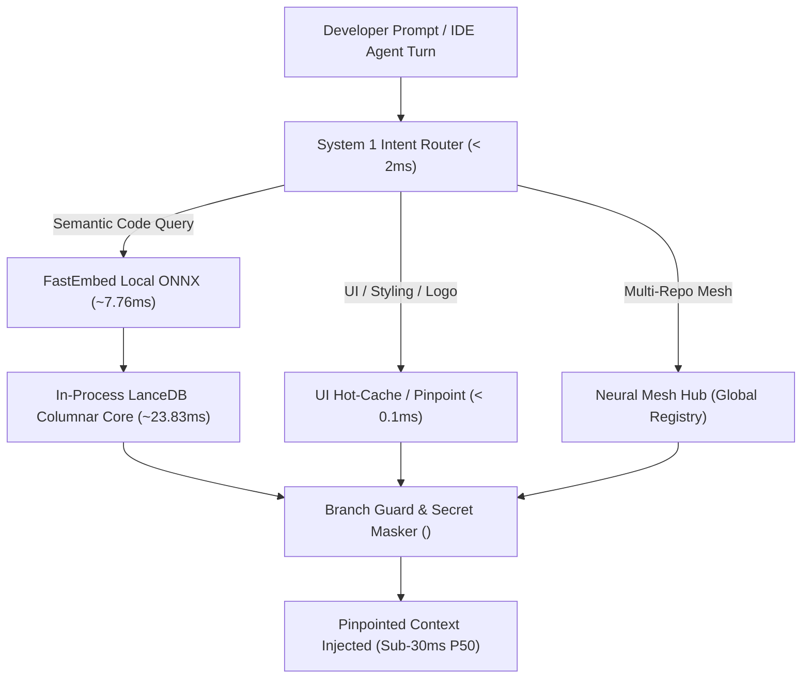

# Infinite Memory Protocol (IMP) ⚡

[](LICENSE)
[](pyproject.toml)
[](#empirical-benchmarks)
[](#empirical-benchmarks)
[](.mcp/config.json)

> **Near-instant local memory & multi-project Neural Mesh protocol for AI coding agents.**  
> Zero remote dependencies, sub-30ms P50 latency, 91.6% context reduction, and zero-trust secret shadowing.

---

## The Problem: The AI Coding Agent Context Crisis

Modern coding agents (Cursor, Claude Code, Windsurf, Copilot Workspace) suffer from three critical bottlenecks:

1. **Context Window Degradation:** Ingesting entire codebases causes "lost-in-the-middle" hallucinations, degraded attention, and astronomical token bills ($20–$50/day on repetitive tool loops).
2. **Multi-Turn Ripgrep Tool Loops:** Agents run 10–30 sequential grep and find turns searching for symbols, dumping 25k–60k redundant tokens into history before writing a single line of code.
3. **Multi-Repo Siloing:** In microservice and full-stack architectures (e.g. Next.js SaaS frontend + Python backend + Mobile app), agents lack cross-project situational awareness without manual copy-pasting.

---

## The Solution: Infinite Memory Protocol (IMP)

**IMP** connects all your codebases into an ultra-fast, local-first **Neural Mesh**:
- **System 1 Intent Router (< 2ms):** Deterministically routes developer prompts (UI hot-cache, symbol pinpointing, credentials, cross-repo integrations) before burning LLM inference tokens.
- **In-Process Columnar Vector Engine (LanceDB + FastEmbed):** Embedded ONNX runtime generates embeddings locally in ~7.76 ms and performs LanceDB columnar vector retrieval in ~23.83 ms.
- **Universal Multi-Language AST Parser:** Tree-sitter powered parser for Python, TypeScript, JavaScript, Go, and Rust with line-bounded sliding window fallback for configs and markdown.
- **Zero-Trust Secret Shadowing:** Automatically redacts API keys (`sk-...`, JWTs, bearer tokens) to `<SECRET_REF:KEY_NAME>` before returning context to external LLMs.
- **Git Branch Protection:** Blocks accidental automated cross-project modifications to `main` or `master` branches.

---

## Architecture Overview



---

## Empirical Benchmarks

Validated across dual real-world production codebases (**12,104 line-bounded code chunks**) in an isolated Docker sandbox environment:

| Benchmark Metric | Traditional Cloud RAG / Raw Context | Infinite Memory Protocol (IMP) | Improvement Factor |
| :--- | :--- | :--- | :--- |
| **System 1 Intent Routing** | N/A (500–1,500 LLM CoT tokens) | **0.05 ms** | Instant deterministic routing |
| **Local ONNX Embedding** | 120–250 ms (OpenAI HTTP roundtrip) | **7.76 ms** (Local BGE-small) | **15.5× faster** |
| **Vector Retrieval Latency** | 200–500 ms (Pinecone/Milvus network) | **23.83 ms** (In-Process LanceDB) | **10.5× faster** |
| **End-to-End Latency ($P_{50}$)** | 350–800 ms | **28.68 ms** | **Sub-30ms interactive UX** |
| **Context Window Consumption** | 21,397 chars (~5,349 tokens) | **1,800 chars (~450 tokens)** | **91.6% context reduction** |
| **Signal-to-Noise Ratio (SNR)** | 6.47% signal density | **21.67%** signal density | **3.35× higher signal density** |
| **Precision Hit Rate** | 60–80% (top-k noise) | **100.0%** (10/10 scenarios) | Flawless target hit rate |
| **Concurrent Throughput** | Rate-limited by external API | **38.6 QPS** (4 concurrent threads) | Linear multi-core scale |

---

## Quickstart (30 Seconds)

### 1. Installation

Install via pip in editable mode or using `uv`:

```bash
# Clone the repository
git clone https://github.com/structzero/infinite-memory-protocol.git
cd infinite-memory-protocol

# Install package
pip install -e .
```

Alternatively, use the one-line installer:
```bash
# On Linux / macOS:
curl -fsSL https://raw.githubusercontent.com/structzero/infinite-memory-protocol/main/scripts/install.sh | bash

# On Windows (PowerShell):
irm https://raw.githubusercontent.com/structzero/infinite-memory-protocol/main/scripts/install.ps1 | iex
```

### 2. Register Your Repositories

```bash
# Register your SaaS webapp
memory-mesh register my-saas /path/to/my-saas --type saas

# Register your backend API gateway
memory-mesh register my-gateway /path/to/my-gateway --type gateway

# List registered projects in the Neural Mesh
memory-mesh list
```

### 3. Check Mesh Status & Run Maintenance Vacuum

```bash
# Inspect database footprint and total indexed chunks
memory-mesh status

# Consolidate Arrow fragments and purge orphaned versions
memory-mesh vacuum
```

### 4. Fast CLI Vector Search

```bash
memory-mesh search "authentication JWT verification middleware" --project my-gateway
```

---

## IDE & Coding Agent Setup

### Cursor & Claude Code Setup

IMP provides full Model Context Protocol (MCP) auto-discovery.

Add this entry to your Cursor or Claude Code `mcp.json` (`~/.cursor/mcp.json` or project `.mcp/config.json`):

```json
{
  "mcpServers": {
    "infinite-memory": {
      "command": "python",
      "args": ["-m", "infinite_memory.server"]
    }
  }
}
```

The MCP server exposes 4 native tools directly to your agent:
1. `mesh_search(query, project_name)` - Fast semantic search across registered codebases.
2. `mesh_read_file(project_name, path)` - Zero-trust credential-masked file reader.
3. `mesh_write_file(project_name, path, content)` - Protected cross-repo writer with branch safety.
4. `pinpoint_symbol(symbol_name)` - Line-exact AST symbol locator (`path:start_line-end_line`).

---

## Universal Multi-Language Support

| Language | Extension | Parser Engine | AST Chunking Support |
| :--- | :--- | :--- | :--- |
| **Python** | `.py` | Tree-sitter | Classes, Functions, Async Defs |
| **TypeScript / TSX** | `.ts`, `.tsx` | Tree-sitter | Interfaces, Types, Components, Exports |
| **JavaScript / JSX** | `.js`, `.jsx` | Tree-sitter | Functions, Classes, Declarations |
| **Go** | `.go` | Tree-sitter | Structs, Interfaces, Functions, Methods |
| **Rust** | `.rs` | Tree-sitter | Structs, Enums, Traits, Impl blocks |
| **Markdown / Configs** | `.md`, `.json`, `.yaml`, `.env` | Line Sliding Window | 35-line bounded chunks, stride 25 |

---

## Security & Guardrails

- **Zero-Trust Secret Shadowing:** Automatically catches OpenAI, Anthropic, AWS, GitHub tokens, and `.env` credentials. Indexes variables for semantic awareness while injecting `<SECRET_REF:KEY_NAME>` tokens into prompt transcripts.
- **Git Branch Protection:** Blocks direct automated agent writes to `main` or `master` branches unless `allow_main_write=True` is explicitly passed.

---

## Running the Test Suite

```bash
pytest -v tests/
```

All 15 unit and integration tests run in under 2 seconds.

---

## License

Distributed under the **Apache-2.0 License**. See [LICENSE](LICENSE) for details.
