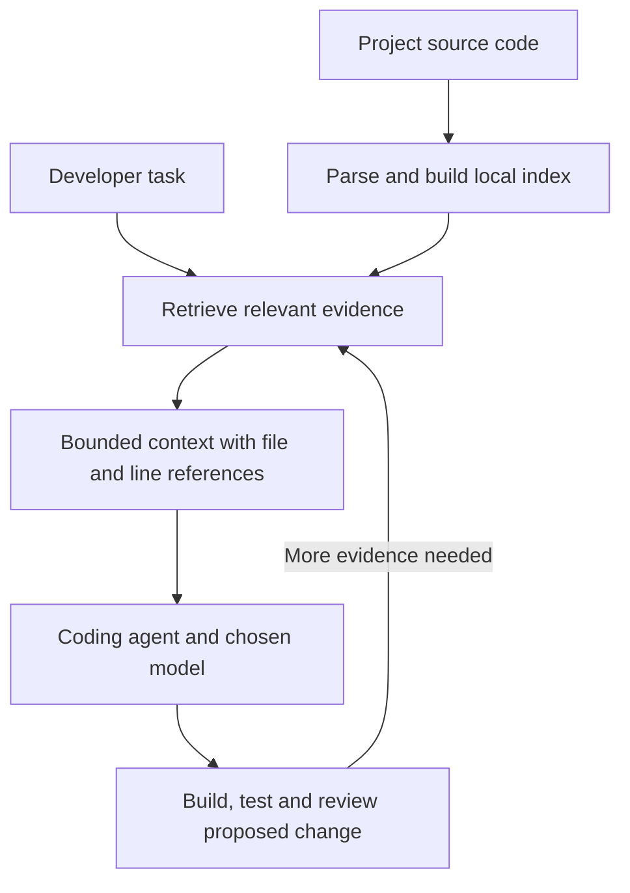

# PolyFabric

### Give AI coding agents the code they need—without sending entire files.

**PolyFabric is a local code-context engine for AI coding agents.** It finds relevant functions, code sections and references in an existing project, then supplies focused context to your chosen language model.

**The value:** less source code in prompts, traceable evidence, and fewer tokens spent on repository context.

| **78/78** | **7.58%** | **Read-only pilot** |
|:---:|:---:|:---:|
| **Reported accepted attempts**, including repairs | **Fewer total tokens** than the previous PolyFabric version | **MCP write rejection and CLI paths checked** |

> [!NOTE]
> **Latest reported comparison:** 26 tasks, three trials per version on [`vishalvermauts/FarmWatch`](https://github.com/vishalvermauts/FarmWatch). The release report is published; its raw head-to-head benchmark directory is not currently published in this repository. Scores are **reported results, not independently certified or guaranteed performance**. Dollar savings remain unreconciled. [Latest report →](docs/POLYFABRIC_RELEASE_READINESS_REPORT.md)

**Local retrieval · Your chosen coding model · MCP or Python integration · Apache 2.0**

**Start here:** [Copy the IDE/agent setup prompt](#easiest-option-paste-this-into-your-ide-or-coding-agent) to use PolyFabric in a new or existing project.

[**Benchmark results**](#measured-results) · [**How it works**](#how-polyfabric-works) · [**StructZero integration**](#planned-integration-with-structzero) · [**Technology**](#technology-stack) · [**Quickstart**](#use-it-in-an-existing-project) · [**Evidence & reports**](#reports-and-further-reading)

---

## What PolyFabric does

- **Finds relevant code:** exact symbols, keyword matches and semantic candidates.
- **Builds focused context:** relevant code intervals instead of repeatedly supplying complete files.
- **Shows where evidence came from:** file paths, symbols and line references.
- **Fits existing agents:** connects through MCP or direct Python APIs; the coding model still generates the answer or patch.

### A practical example

> **Developer request:** “Change the soil-moisture alert threshold.”

An agent needs the relevant alert logic and enough surrounding context to edit it correctly. PolyFabric helps locate and assemble that evidence instead of supplying several complete components. The agent must still build, test and review the proposed change.

**Smaller prompts matter only when the agent still completes the task correctly.** That is why the benchmark below reports task acceptance alongside token consumption.

---

## Measured results

### Latest version comparison: reported head-to-head results

The [release readiness report](docs/POLYFABRIC_RELEASE_READINESS_REPORT.md) compares baseline `eda7e0e` with improved `2ce529e` on FarmWatch at commit `201321eb045f9b5170007fc26def90e4d13bf564`, using `gemini-2.5-flash`. **26 tasks × 3 trials × 2 versions = 156 attempts**, with at most one repair per attempt.

| Reported measurement | Previous PolyFabric | Improved PolyFabric |
|---|---:|---:|
| Accepted attempts, including repair | 75/78 (96.15%) | **78/78 (100%)** |
| Accepted before repair | 65/78 | **71/78** |
| Repairs attempted / successful | 13 / 10 | **7 / 7** |
| Prompt tokens | 255,968 | 253,527 |
| Completion tokens | 71,682 | 49,292 |
| Total tokens | 327,650 | **302,819** |
| Indexed project chunks | 924 | 642 |
| Median warm retrieval | 32.26 ms | 23.32 ms |

**Reported improvement: 7.58% fewer total tokens and 3.85 percentage points higher final acceptance.** The three baseline failures repeat one task (UI-02); these are 26 previously used tasks, not an unseen test set. Multiple implementation changes were evaluated together. The report also records lower indexing time and peak RSS, with measurement qualifications.

**Evidence availability:** the report describes `RUN_HEAD_TO_HEAD_BASELINE_VS_IMPROVED`, but that raw directory was absent from published `main` during this README update. These headline counts have not been independently recomputed here. Do not treat the report alone as raw-data verification.

The hardened candidate `9ca5287` subsequently added read-only enforcement and CLI path normalization. Its separate [verification summary](benchmarks/results/PILOT_VERIFICATION_9CA5287/verification_summary.json), [execution log](benchmarks/results/PILOT_VERIFICATION_9CA5287/execution_log.txt), and [scripts](benchmarks/verify_candidate_9ca5287/) are published. The recorded checks passed actual MCP write rejection, unchanged existing files, no new file creation, successful reads, and relative CLI paths. These checks do not constitute another coding benchmark. Offline operation was optional and not verified with OS-level network isolation.

### Historical comparison against search baselines

> **Historical run with later audit qualifications:** the figures below describe the older `RUN_20261013_FARMWATCH_3KEY_CORRECTED` run. Later review reported shared-worktree contamination and overwritten supporting artifacts. Retain these as historical observations, not the current release score or an uncontested comparison. See the [later audit discussion](docs/POLYFABRIC_RELEASE_READINESS_REPORT.md) and [historical evidence](docs/EVIDENCE.md).


The comparison used the same TypeScript/React/Express project, `gemini-2.5-flash`, and **26 tasks × 3 trials × 3 approaches = 234 evaluated attempts**. Each approach had 78 attempts, with at most one repair request per attempt.

- **PolyFabric:** retrieved code snippets assembled into task context.
- **Targeted search:** `rg` (ripgrep) searches and bounded file reads. This is a separate baseline, not a PolyFabric function.
- **Whole-file context:** complete files supplied by the benchmark's context-gathering policy. This does not represent every competing coding agent.

| Recorded measurement | PolyFabric | Targeted `rg` search | Whole-file context |
|---|---:|---:|---:|
| Prompt/input tokens | **252,957** | 534,309 | 9,658,300 |
| Completion/output tokens | 81,150 | 95,488 | 88,280 |
| Total input + output tokens | **334,107** | 629,797 | 9,746,580 |
| Accepted attempts, including repairs | **74/78 (94.87%)** | 64/78 (82.05%) | 62/78 (79.49%) |
| Accepted before repair | 59/78 | 54/78 | 57/78 |
| Model requests, including repairs | 97 | 102 | 99 |
| Median end-to-end time per attempt | 6.86 s | **4.58 s** | 8.03 s |

| PolyFabric reduction | Versus targeted search | Versus whole-file context |
|---|---:|---:|
| Prompt/input tokens | **52.66%** | **97.38%** |
| Total input + output tokens | **46.95%** | **96.57%** |

**What this shows:** in this recorded run, smaller context coincided with higher task acceptance than both baselines. PolyFabric was faster than whole-file context at the median, but slower than targeted search. End-to-end timing includes work beyond model generation; token savings do not guarantee faster responses.

**What remains unverified:** dollar savings. LiteLLM gateway spending has not been reconciled with the client ledger. Provider pricing, cached inputs, reasoning tokens and retrieval/indexing overhead affect economics. We do not equate 97.38% fewer prompt tokens with 97.38% lower API bills.

This is an internal, single-codebase benchmark, not independent certification. The three trials repeat the same 26 tasks; they are not 78 distinct tasks. Some launch metadata was not captured. “Accepted” means accepted by the runner's checks, not a production deployment guarantee.

**Verify the evidence:** [summary](benchmarks/results/RUN_20261013_FARMWATCH_3KEY_CORRECTED/summary.json) · [298 request records](benchmarks/results/RUN_20261013_FARMWATCH_3KEY_CORRECTED/client_request_ledger.jsonl) · [234 attempt outcomes](benchmarks/results/RUN_20261013_FARMWATCH_3KEY_CORRECTED/per_attempt_results.jsonl) · [task manifest](benchmarks/results/RUN_20261013_FARMWATCH_3KEY_CORRECTED/task_manifest.json) · [billing disclosures](benchmarks/results/RUN_20261013_FARMWATCH_3KEY_CORRECTED/reconciliation_report.json).

The table's token totals and acceptance counts were cross-checked against those saved ledgers for this documentation update. **No experiments were rerun.** See the [evidence guide](docs/EVIDENCE.md) for the methodology, limitations and other reports.


---

## How PolyFabric works

1. **Index the project.** Parse supported source files into code chunks with file, symbol and line metadata. Create local embeddings and store the records.
2. **Find relevant evidence.** Search exact symbols, lexical matches and vector similarity. Hybrid ranking combines lexical and semantic candidates; repository-aware retrieval supports multi-project queries.
3. **Assemble task context.** Select relevant files and code intervals, include surrounding context, and format evidence for the coding agent.
4. **Let the agent act and verify.** The model proposes a change. The host agent or application applies its own build, test, review and approval workflow.



Local retrieval does not require a paid generative-model call. Embedding weights require an initial download; inference can then run locally with cached dependencies and weights. If the host agent uses a cloud model, the supplied context still goes to that provider.


---

## Planned integration with StructZero

[StructZero](https://www.structzero.app/) coordinates AI agents to **plan, build and verify software**.

> **Planned role: PolyFabric becomes StructZero's shared code-context layer, retrieving relevant evidence before each agent calls a model.**

**Status: planned integration.** The FarmWatch results are not measurements of a deployed StructZero integration.

**The intended flow:** for each task, StructZero would request a bounded evidence pack from PolyFabric before calling a model. Agents would receive the relevant code, references and task instructions. After an edit, the index and any reused evidence would be refreshed or invalidated against the new project version.

| StructZero workflow | Planned use of PolyFabric | Intended benefit |
|---|---|---|
| Code generation and editing | Retrieve existing components, interfaces and nearby implementation before proposing changes | Reduce source text in prompts while preserving project context |
| Debugging and repair | Retrieve code relevant to a failing check; expand evidence when the first context is incomplete | Reduce repeated broad file reads and unnecessary model turns |
| Multi-agent debate and review | Give agents versioned evidence packs and require references for code-related claims | Reduce repeated repository discovery; make disagreement easier to inspect |
| Security review | Supply relevant source to security reviewers and scanners | Focus review context; retrieval itself does not establish security |
| Android pipeline debugging | Start with supported backend/shared-code context; add and validate Java/Kotlin, Gradle and build-log support | Extend focused retrieval to Android-specific failures after connector/parser work |
| Research and architecture | Ground code-related research in repository evidence; add document connectors separately | Connect recommendations to implementation; external research retrieval is not currently established |

Before rollout, StructZero would need project/tenant access controls, commit-aware context reuse, token budgets, stale-index detection, fallback reads and per-agent usage attribution. A shared evidence pack still consumes tokens when sent to each model; reuse does not make those calls free.

**Success would be measured by tokens and reconciled cost per accepted task**, alongside latency and failure rates, against StructZero's existing workflow. The FarmWatch percentages are evidence to investigate this opportunity, not a forecast of StructZero savings.


---

## Technology stack

| Layer | Technology and role |
|---|---|
| Core | Python 3.10+; package name `infinite-memory-protocol` |
| Code parsing | Tree-sitter for Python, TypeScript/TSX, JavaScript, Go and Rust; sliding-window fallback for other indexed text formats |
| Local embeddings | FastEmbed with ONNX Runtime; default `BAAI/bge-small-en-v1.5`, 384 dimensions |
| Storage and search | Embedded LanceDB; lexical/FTS search and vector retrieval |
| Ranking | Exact/fuzzy symbol routes, hybrid reciprocal rank fusion and repository diversity handling |
| Agent interface | MCP stdio server and direct Python APIs |
| File updates | Watchdog-based watchers and file-level indexing operations |
| Optional investigation | Bounded System 2 investigation layer; real-model use needs a configured provider |
| License | Apache 2.0 |

Dependencies and version ranges are recorded in [pyproject.toml](pyproject.toml). See [the implementation](src/infinite_memory/) for the current contracts.


---

## Use it in an existing project

### Easiest option: paste this into your IDE or coding agent

Use an agent with terminal access and an MCP-capable client. **A repository URL alone does not automatically connect tools or give the agent access to your project.** The agent must install PolyFabric, configure its client, and index your chosen directory.

```text
Set up PolyFabric for this project's code search and task context:
https://github.com/vishalvermauts/PolyFabric

Read its current README and source before setup. Clone PolyFabric into a
separate tools directory outside my target project, create a dedicated
Python virtual environment, and install it with python -m pip install -e .

Use this project's absolute root and a unique project name. Set an isolated,
absolute INFINITE_MEMORY_HOME and INFINITE_MEMORY_DB_PATH outside the source
tree; use the same values for indexing and the MCP server.

Configure this IDE's supported MCP settings using the virtual environment's
absolute Python executable, args ["-m", "infinite_memory.server"], and:
POLYFABRIC_ENABLE_SERVER=1
POLYFABRIC_READ_ONLY=1
INFINITE_MEMORY_HOME=<absolute state directory>
INFINITE_MEMORY_DB_PATH=<absolute database directory>

Preserve existing MCP settings. If this client cannot configure MCP
automatically, show me the exact configuration and restart instructions.
Do not claim the connection works until you initialize MCP and list tools.

Index/register my project through mesh_index_repository(project_name,
repository_path). Inspect indexing errors and chunk counts. Demonstrate
mesh_build_task_context on a real symbol or feature from this project.
If it is empty, explain that there is no source to retrieve yet.

For later coding tasks, call mesh_build_task_context before proposing edits;
use project-scoped search and expand incomplete evidence with direct reads
or exact reference searches. Refresh the index after source changes.
Do not assume all callers or imports are present in bounded context.

Keep PolyFabric source-write mode disabled. Let the coding agent propose
changes through its normal review, build and test workflow. Do not alter my
project merely to demonstrate setup, run benchmarks, or make paid LLM calls.
Report install location, installed Git commit, project name, state paths,
MCP connection status, and a sample retrieval.
```

**Existing project:** point setup at the current source directory; no restructuring is required. **New project:** create the normal project scaffold first, then index it once source files exist. PolyFabric retrieves existing code; the chosen coding model generates new code.

### Manual install

Git and Python 3.10+ are required by the package. Dependency compatibility depends on platform and resolved versions; version ranges are in [pyproject.toml](pyproject.toml), not an exact lockfile. First use downloads embedding weights. No generative API key is needed for local retrieval.

Clone outside the target project:

```bash
git clone https://github.com/vishalvermauts/PolyFabric.git
cd PolyFabric
python -m venv .venv
```

**macOS / Linux:**

```bash
.venv/bin/python -m pip install -e .
export INFINITE_MEMORY_HOME="$HOME/.polyfabric/my-project"
export INFINITE_MEMORY_DB_PATH="$HOME/.polyfabric/my-project/db"
export POLYFABRIC_READ_ONLY=1
.venv/bin/python -m infinite_memory.cli register my-project /absolute/path/to/project
```

**Windows PowerShell:**

```powershell
.\.venv\Scripts\python.exe -m pip install -e .
$env:INFINITE_MEMORY_HOME = "$env:USERPROFILE\.polyfabric\my-project"
$env:INFINITE_MEMORY_DB_PATH = "$env:USERPROFILE\.polyfabric\my-project\db"
$env:POLYFABRIC_READ_ONLY = "1"
.\.venv\Scripts\python.exe -m infinite_memory.cli register my-project "C:\absolute\path\to\project"
```

Use a unique name and state directory for each project. Registration indexes existing source and may take time. To reproduce the targeted pilot-check code rather than follow current `main`, check out `9ca5287f717670941330b4202f0fb6ba606f797e` before installing.

### Connect your IDE through MCP

Place this entry in your client's supported MCP configuration, replacing every placeholder with an absolute path. Clients have different settings locations; this is the server entry, not a universal configuration filename.

```json
{
  "mcpServers": {
    "polyfabric": {
      "command": "/absolute/path/to/PolyFabric/.venv/bin/python",
      "args": ["-m", "infinite_memory.server"],
      "env": {
        "POLYFABRIC_ENABLE_SERVER": "1",
        "POLYFABRIC_READ_ONLY": "1",
        "INFINITE_MEMORY_HOME": "/absolute/path/to/polyfabric-state/my-project",
        "INFINITE_MEMORY_DB_PATH": "/absolute/path/to/polyfabric-state/my-project/db"
      }
    }
  }
}
```

On Windows, use `C:/absolute/path/to/PolyFabric/.venv/Scripts/python.exe` and absolute Windows state paths. Match the home/database paths used during registration. Restart or reconnect the client after configuration.

Ask the agent:

```text
Use PolyFabric to list registered projects. For my-project, build task
context for "<describe a real feature or symbol>". Show the source paths
and line references. Retrieve more evidence if the context is incomplete.
```

For registration through MCP instead of the CLI, call `mesh_index_repository(project_name, repository_path)`. For tasks, use `mesh_build_task_context(instruction, project_name, max_files=6)` or `mesh_fast_search(query, project_name=...)`.

**Read-only mode blocks PolyFabric's source-file write tool; indexing still writes its own database and registry.** It does not restrict writes made by the host IDE/agent through other tools.

### Direct Python use

```python
from pathlib import Path
from infinite_memory.core.indexer import index_repository
from infinite_memory.core.store import VectorStore
from infinite_memory.core.task_context import build_task_context

repo_root = Path("/absolute/path/to/project").resolve()
store = VectorStore(db_path="/absolute/path/to/polyfabric-state/my-project/db")
stats = index_repository(repo_root, "my-project", store=store)
print(stats)  # Inspect errors and completeness before relying on results.
context = build_task_context(
    store=store,
    instruction="Find the code that handles <your feature>",
    repo_root=repo_root,
    project_name="my-project",
    max_files=6,
)
print(context["context_text"])
```

This Python example supplies context to your application; it does not configure an IDE or register a root with the MCP hub.

### Troubleshooting

- **No tools / server exits:** confirm `POLYFABRIC_ENABLE_SERVER=1`, the correct virtual-environment interpreter, and MCP client stderr.
- **Project missing / empty search:** confirm absolute project path, matching home/database settings, indexed source, and project name. Inspect indexing errors; reindex after edits if needed.
- **Initial setup cannot download weights:** allow the initial download or provision the model cache. The pilot checks do not establish complete air-gapped support.
- **Incomplete references:** combine retrieved context with direct file reads and exhaustive symbol/call-site checks before broad refactoring.
- **Memory use:** size for your actual project; historical RSS observations are not a minimum-memory guarantee.

These instructions were checked against published source and saved verification scripts. No installation, indexing, models, or benchmarks were executed for this documentation update.


---

## Current boundaries and development status

- **Beta:** intended for evaluation and controlled integration. Broad concept search, typo handling and cross-project evidence remain uneven; global refactoring needs complete reference checks.
- **Memory and indexing are real costs:** a separate saved FarmWatch verification recorded approximately 3.77 GB peak process RSS. That is not benchmark-wide or universal memory usage, and no sub-250-MB guarantee is made.
- **Evidence can be incomplete:** neither retrieval nor secret masking guarantees correctness, absence of hallucinations, or security. Host-side validation remains necessary.
- **Experimental results stay separate:** the [earlier improvement-plan experiment](https://github.com/vishalvermauts/PolyFabric/blob/732f529da33aa60e214067ae473e65ee66c45dbf/benchmarks/results/plan_experiment_20261015/report.md) used a different corpus/embedding policy. Do not combine those scores with coding-task results or treat them as proof of API-token savings.
- **Historical corrections remain visible:** invalid retrieval runs and unresolved billing are retained in the [evidence guide](docs/EVIDENCE.md), rather than combined into a best-case headline.


---

## Reports and further reading

- [Evidence guide: methodology, raw records and all report locations](docs/EVIDENCE.md)
- [Historical retrieval benchmarks and ablation studies](docs/benchmarks/README.md)
- [All recorded benchmark artifacts](benchmarks/results/)
- [Test source](tests/) and [CI workflow](.github/workflows/test.yml) — existing checks, not a fresh test run for this edit
- [Previous detailed README, preserved as a historical snapshot](docs/README_ARCHIVE_20261015.md)
- [License](LICENSE)
