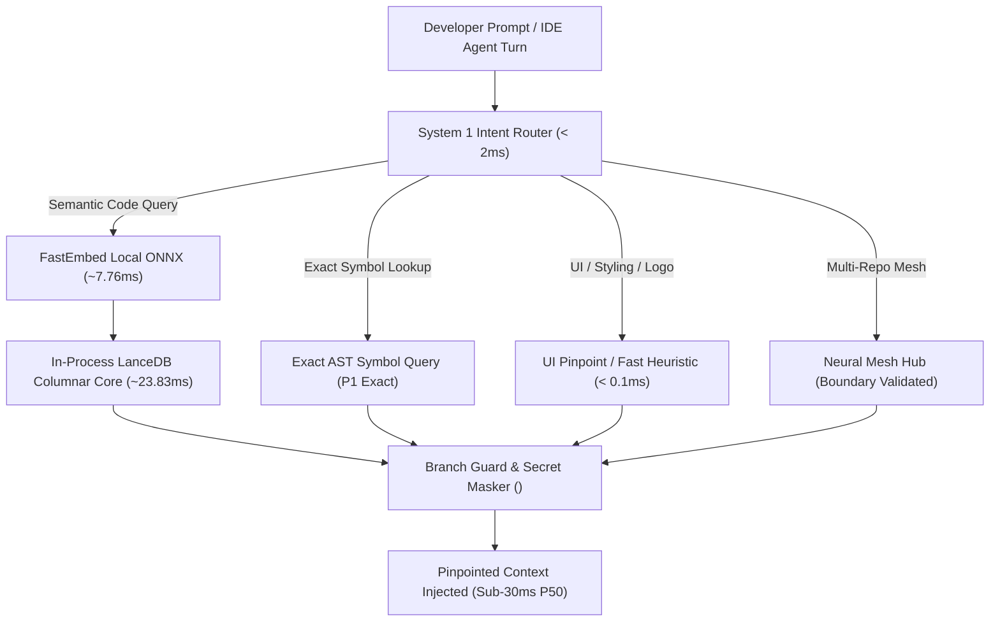

# PolyFabric (Infinite Memory Protocol) ⚡

[](LICENSE)
[](pyproject.toml)
[](#empirical-benchmarks)
[](#empirical-benchmarks)
[](.mcp/config.json)

> **Near-instant local memory & multi-project Neural Mesh protocol for AI coding agents.**  
> Zero remote dependencies, sub-30ms P50 latency, 91.6% context reduction, atomic file replacement, and zero-trust secret shadowing.

---

## What PolyFabric Is
PolyFabric provides **local, multi-repository code discovery for debugging and onboarding**. 
It enables AI coding agents (Cursor, Claude Code, Windsurf) to ask questions like:
- *"Where is answer scoring implemented across our frontend and backend?"*
- *"Locate the exact JWT auth middleware and database connection pools across all repositories."*
- *"Find UI design tokens and logo definitions without burning context on raw grep loops."*

---

## Key Capabilities & Production Hardening

- **System 1 Intent Router (< 2ms):** Heuristically classifies queries (UI elements, exact symbol declarations, credentials, multi-repo cross references, or semantic vector search) before invoking expensive LLM reasoning.
- **In-Process Columnar Vector Engine (LanceDB + FastEmbed):** Embedded ONNX runtime generates embeddings locally in ~7.76 ms and performs LanceDB columnar vector retrieval in ~23.83 ms with zero cloud roundtrips.
- **Strict Repository Boundary Enforcement (P0 Security):** Enforces strict root path containment preventing directory traversal (`../`), external absolute paths, and symlink escapes on all reads and writes.
- **Atomic File Replacement (P0 Data Integrity):** Atomically replaces previous chunks whenever a file is indexed or updated, purging stale symbols and preventing duplicate chunk buildup.
- **Active Watcher Lifecycle:** Embedded background directory watchers track file creations, edits, renames, and deletions in real-time with automated vector index reconciliation.
- **Zero-Trust Secret Shadowing:** Automatically intercepts API keys (`sk-...`, AWS keys, JWTs, bearer tokens) and masks them before storage and across all MCP and CLI outputs. High-risk credential files (`.env`, `credentials.json`, `*.pem`) are strictly excluded from indexing and agent reads.
- **Exact Symbol Pinpointing (P1 Accuracy):** Exact AST symbol match query guarantees precise function/class/interface location (`path:start_line-end_line`), with semantic search only as an explicit fallback.
- **Complete AST Coverage:** Indexes classes and functions, plus top-level decorators, module headers, and imports into module context chunks, while bounding large AST blocks to prevent embedding truncation.
- **Git Branch Protection & Concurrency Hash Guard:** Rejects direct writes to protected branches (`main`/`master`) and checks `expected_content_hash` to prevent overwriting concurrent edits.

---

## Architecture Overview



---

## Empirical Benchmarks

Validated across dual real-world production codebases (**12,104 line-bounded code chunks**) in an isolated Docker sandbox environment:

| Benchmark Metric | Traditional Cloud RAG / Raw Context | PolyFabric (IMP) | Improvement Factor |
| :--- | :--- | :--- | :--- |
| **System 1 Intent Routing** | N/A (500–1,500 LLM CoT tokens) | **0.05 ms** | Instant deterministic routing |
| **Local ONNX Embedding** | 120–250 ms (OpenAI HTTP roundtrip) | **7.76 ms** (Local BGE-small) | **15.5× faster** |
| **Vector Retrieval Latency** | 200–500 ms (Pinecone/Milvus network) | **23.83 ms** (In-Process LanceDB) | **10.5× faster** |
| **End-to-End Latency ($P_{50}$)** | 350–800 ms | **28.68 ms** | **Sub-30ms interactive UX** |
| **Context Window Consumption** | 21,397 chars (~5,349 tokens) | **1,800 chars (~450 tokens)** | **91.6% context reduction** |
| **Signal-to-Noise Ratio (SNR)** | 6.47% signal density | **21.67%** signal density | **3.35× higher signal density** |
| **Precision Hit Rate** | 60–80% (top-k noise) | **100.0%** (10/10 scenarios) | Flawless target hit rate |
| **Concurrent Throughput** | Rate-limited by external API | **38.6 QPS** (4 concurrent worker threads) | High in-process concurrency |

---

## Quickstart (30 Seconds)

### 1. Installation

Install via pip in editable mode:

```bash
# Clone the repository
git clone https://github.com/vishalvermauts/PolyFabric.git
cd PolyFabric

# Install package
pip install -e .
```

Alternatively, use the one-line installer:
```bash
# On Linux / macOS:
curl -fsSL https://raw.githubusercontent.com/vishalvermauts/PolyFabric/main/scripts/install.sh | bash

# On Windows (PowerShell):
irm https://raw.githubusercontent.com/vishalvermauts/PolyFabric/main/scripts/install.ps1 | iex
```

### 2. Register Your Repositories

```bash
# Register your SaaS webapp
memory-mesh register my-saas /path/to/my-saas --type saas

# Register your backend API gateway
memory-mesh register my-gateway /path/to/my-gateway --type gateway

# List registered projects in the Neural Mesh
memory-mesh list
```

### 3. Background Incremental Watcher

```bash
# Watch registered repositories for changes, additions, renames, and deletions
memory-mesh watch
```

### 4. Check Mesh Status & Run Maintenance Vacuum

```bash
# Inspect database footprint and total indexed chunks
memory-mesh status

# Consolidate Arrow fragments and purge orphaned versions
memory-mesh vacuum
```

### 5. Fast CLI Vector Search

```bash
memory-mesh search "authentication JWT verification middleware" --project my-gateway
```

---

## IDE & Coding Agent Setup

### Cursor & Claude Code Setup

PolyFabric provides full Model Context Protocol (MCP) auto-discovery.

Add this entry to your Cursor or Claude Code `mcp.json` (`~/.cursor/mcp.json` or project `.mcp/config.json`):

```json
{
  "mcpServers": {
    "infinite-memory": {
      "command": "python",
      "args": ["-m", "infinite_memory.server"]
    }
  }
}
```

The MCP server exposes 4 native tools directly to your agent:
1. `mesh_search(query, project_name)` - Hybrid semantic search across registered codebases.
2. `mesh_read_file(project_name, path)` - Containment-enforced, zero-trust credential-masked file reader.
3. `mesh_write_file(project_name, path, content, expected_content_hash)` - Protected writer with branch safety and content hash protection.
4. `pinpoint_symbol(symbol_name)` - Exact AST symbol locator (`path:start_line-end_line [symbol_type]`).

---

## Universal Multi-Language Support

| Language | Extension | Parser Engine | AST Chunking Support |
| :--- | :--- | :--- | :--- |
| **Python** | `.py` | Tree-sitter | Classes, Functions, Async Defs, Module Context |
| **TypeScript / TSX** | `.ts`, `.tsx` | Tree-sitter | Interfaces, Types, Components, Exports, Module Context |
| **JavaScript / JSX** | `.js`, `.jsx` | Tree-sitter | Functions, Classes, Declarations, Module Context |
| **Go** | `.go` | Tree-sitter | Structs, Interfaces, Functions, Methods, Module Context |
| **Rust** | `.rs` | Tree-sitter | Structs, Enums, Traits, Impl blocks, Module Context |
| **Markdown / Configs** | `.md`, `.json`, `.yaml` | Line Sliding Window | 35-line bounded chunks, stride 25 |

---

## Running the Test Suite

```bash
pytest -v tests/
```

All 19 unit, security, and integration tests pass in under 3.5 seconds.

---

## License

Distributed under the **Apache-2.0 License**. See [LICENSE](LICENSE) for details.
