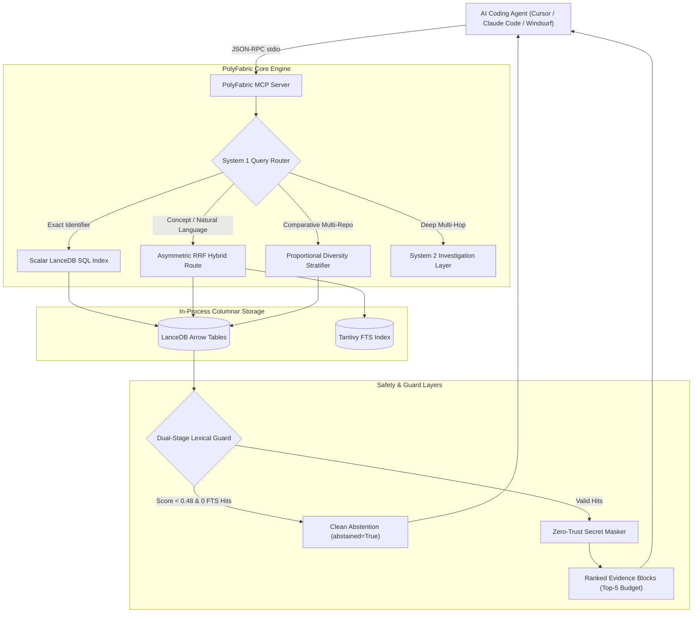
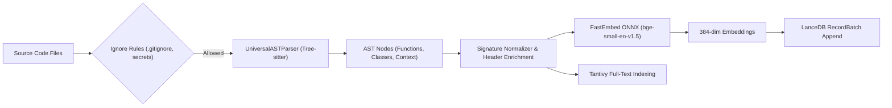
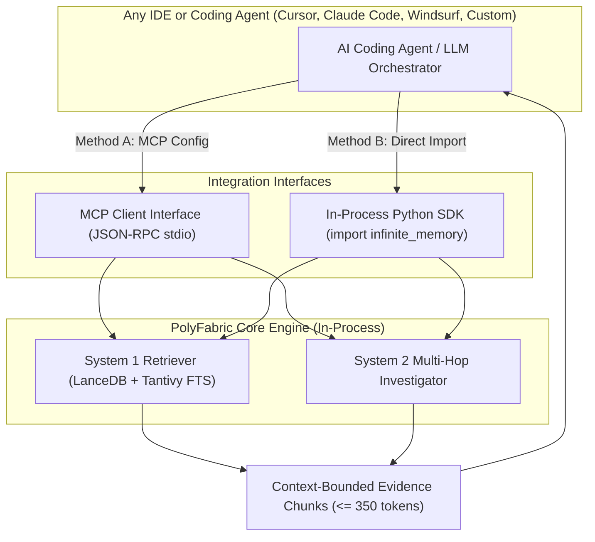

# PolyFabric (Infinite Memory Protocol) ⚡

[](LICENSE)
[](pyproject.toml)
[](tests/)
[](src/infinite_memory/server.py)

> **In-process, multi-repository code discovery and context engine for AI coding agents.**  
> Native Tree-sitter AST parsing, embedded LanceDB columnar vector storage, fast reciprocal rank fusion, and Model Context Protocol (MCP) tool serving without mandatory cloud dependencies.

---

## Table of Contents
1. [Overview & Problem Statement](#overview--problem-statement)
2. [What "System 1" Means Here](#what-system-1-means-here)
3. [System 2 Architecture & Execution Modes](#system-2-architecture--execution-modes)
4. [Supported Capabilities vs Limitations](#supported-capabilities-vs-limitations)
5. [Architecture Diagrams](#architecture-diagrams)
6. [Repository Layout](#repository-layout)
7. [Supported Languages & Parsers](#supported-languages--parsers)
8. [Installation & Setup](#installation--setup)
9. [Configuration & Environment Variables](#configuration--environment-variables)
10. [Indexing & Querying Repositories](#indexing--querying-repositories)
11. [Index Updates & File Deletions](#index-updates--file-deletions)
12. [Model Context Protocol (MCP) Server](#model-context-protocol-mcp-server)
13. [Python SDK Usage](#python-sdk-usage)
14. [Integrating PolyFabric into Any IDE or Agent](#integrating-polyfabric-into-any-ide-or-agent)
15. [Evidence Format, Abstention & Security](#evidence-format-abstention--security)
16. [Models & Dimensionality](#models--dimensionality)
17. [Storage, Persistence & Backup](#storage-persistence--backup)
18. [Troubleshooting & Known Failure Cases](#troubleshooting--known-failure-cases)
19. [Benchmark History & Performance Reports](#benchmark-history--performance-reports)
20. [Coding Task Evaluation: Quality, Context and Cost](#coding-task-evaluation-quality-context-and-cost)
21. [Contributing & License](#contributing--license)

---

## Overview & Problem Statement

Modern coding agents (e.g. Cursor, Claude Code, Windsurf) struggle with large, multi-repository codebases. When searching for cross-cutting concepts or exact function implementations, agents frequently:
1. **Burn Context on Shell Loops:** Running repeated `grep`, `find`, or `ripgrep` commands exhausts context tokens and increases agent turns.
2. **Lose Precision with Naive Dense Vectors:** Standard semantic search matches generic terms or docstrings but misses exact function signatures, interface declarations, and variable definitions.
3. **Suffer Single-Repo Starvation:** In multi-repo projects, the largest repository crowds out minority framework evidence when ranked globally.
4. **Hallucinate on Missing Symbols:** Dense vector searches return distant matches with weak cosine similarity rather than cleanly abstaining when a symbol does not exist.

PolyFabric addresses these challenges with **in-process code indexing**, **dual-route retrieval**, and **proportional multi-repository stratification** over embedded LanceDB tables.

---

## What "System 1" Means Here

> [!IMPORTANT]
> **System 1 is a retrieval architecture, NOT a separately trained foundation model.**

In cognitive dual-process theory, "System 1" refers to rapid, subconscious pattern-matching, whereas "System 2" refers to deliberate reasoning. In PolyFabric:
* **System 1 (`System1Retriever`)** is a fast (<15ms P50), deterministic retrieval pipeline implemented in Python and Rust (via LanceDB and Tantivy). It routes queries across exact symbol indices, full-text lexical search (FTS BM25), dense vector embeddings, or fused hybrid routes without invoking an LLM.
* **System 1 routes:**
  - `exact_symbol`: Direct scalar SQL query matching function, class, or type names.
  - `fts`: Pure Tantivy BM25 lexical keyword search.
  - `dense`: In-process cosine vector search using ONNX FastEmbed embeddings.
  - `hybrid`: Asymmetric Reciprocal Rank Fusion ($k_{\text{lex}}=65, k_{\text{vec}}=38$) combining BM25 and vector results.
  - `stratified`: Multi-repository round-robin evidence allocation.
  - `fuzzy_symbol`: Levenshtein distance matching for handling typos in identifier names.

---

## System 2 Architecture & Execution Modes

**System 2 (`System2Investigator`)** is an optional investigation layer designed for multi-hop graph exploration, relationship classification, and iterative hypothesis verification across codebases.

### Behavior & Real-Model Configuration Requirements
* **API Providers:** System 2 supports calling real LLM providers via LiteLLM (`anthropic/claude-3-5-sonnet`, `gemini/gemini-1.5-pro`, `openai/gpt-4o`).
* **Environment Keys Required:** `ANTHROPIC_API_KEY`, `GEMINI_API_KEY`, or `OPENAI_API_KEY`.
* **Budget Limits:** Every investigation is bounded by a maximum turn counter (`max_turns=5`) and an explicit token cost limit.
* **Fallback Behavior:** If no LLM API key is provided, System 2 falls back to a deterministic rule-based relationship classifier that inspects import statements and symbol references via Tree-sitter.
* **Test Verification Status:** The automated test suite (`tests/test_system2.py`) verifies the bounded execution loop and fallback mechanics using **mocked providers and deterministic local trees**, ensuring tests run offline without consuming paid API credits.

---

## Supported Capabilities vs Limitations

### Fully Supported & Tested Capabilities
* **In-process vector and lexical indexing:** FastEmbed (`BAAI/bge-small-en-v1.5`, 384 dimensions) with LanceDB and Tantivy.
* **Exact Symbol Resolution:** Sub-15ms P50 exact AST matching with 100% Hit@5 across real TypeScript, FastAPI, Flask, and Express repos.
* **Dual-Stage Clean Abstention:** Bordeline vector candidates (<0.48 cosine similarity) with 0 BM25 hits are cleanly rejected (`abstained=True`).
* **Model Context Protocol (MCP):** Full stdio server with tools `mesh_fast_search`, `mesh_exact_symbol`, `mesh_deep_investigate`, `mesh_index_repository`, `mesh_list_projects`, and `mesh_status`.
* **Zero-Trust Secret Masking:** Intercepts API tokens (`sk-...`, AWS keys, JWTs) and replaces them with `<SECRET_REF:...>` tokens.

### Current Limitations & Non-Claims
* **No "Zero Hallucination" Guarantee:** While clean abstention was 100% (4/4 and 20/20) on small absent control sets, this only measures retriever rejection of non-existent symbols, not conversational LLM generation.
* **Cross-Repo Evidence Bottleneck:** In queries requiring evidence from multiple distinct repositories inside a strict Top-5 window, minority framework coverage achieved 25% (1/4) on unseen queries; full cross-repo reasoning often requires higher budgets (`top_k >= 10`).
* **Tree-Sitter Decorator Severing:** Current function node extraction can sever decorators (e.g. `@app.get(...)`), placing them into module context chunks rather than attaching them to function signatures.

---

## Architecture Diagrams

### 1. Overall System Architecture


### 2. Ingestion, Parsing & Indexing Pipeline


### 3. Standalone Agent & IDE Integration Workflow


---

## Repository Layout

```
PolyFabric/
├── src/infinite_memory/
│   ├── core/
│   │   ├── system1.py       # System 1 retriever (RRF, abstention, exact symbol)
│   │   ├── system2.py       # System 2 bounded investigator (multi-hop graph)
│   │   └── store.py         # LanceDB vector and scalar store
│   ├── parsers/
│   │   ├── tree_sitter_ast.py # Universal Tree-sitter multi-language parser
│   │   └── base.py          # AST chunk and node definitions
│   ├── utils/
│   │   └── secret_masker.py # Regex secret interceptor and masking guard
│   └── server.py            # Model Context Protocol (MCP) stdio server
├── benchmarks/
│   ├── results/             # Raw JSON benchmark outputs and run reports
│   ├── run_genuinely_new_evaluation.py # Clean evaluator for unseen queries
│   ├── run_ablation_and_held_out.py    # Ablation matrix runner
│   └── query_ground_truth_manifest.json# Historical 150-query tuning manifest
├── docs/
│   └── benchmarks/
│       └── README.md        # Comprehensive benchmark run history & disclosures
├── tests/                   # 92 unit and integration tests
├── pyproject.toml           # Project metadata and dependencies
└── docker-compose.yml       # Production sandbox container definition
```

---

## Supported Languages & Parsers

Tree-sitter parsers are pre-compiled and tested for the following language targets:

| Language | Verified Extensions | Supported Constructs Extracted | Limitations Identified |
| :--- | :--- | :--- | :--- |
| **Python** | `.py` | `function_definition`, `class_definition`, `async_function` | Decorators placed in module context if unattached |
| **TypeScript** | `.ts`, `.tsx` | `interface_declaration`, `class_declaration`, `function_declaration` | Multi-thousand line compiler files have manifest offset drift |
| **JavaScript** | `.js`, `.jsx`, `.mjs` | `function_declaration`, `method_definition`, `class_declaration` | Prototype assignments parsed as variable statements |
| **Rust** | `.rs` | `function_item`, `impl_item`, `struct_item` | Trait implementations bound to impl blocks |
| **Go** | `.go` | `function_declaration`, `method_declaration`, `type_spec` | Verified via generic AST fallback |

---

## Installation & Setup

### Environment Prerequisites
* **Operating System:** Linux, macOS, or Windows (WSL recommended for local LanceDB speed).
* **Python:** 3.10, 3.11, or 3.12 (Python 3.11 recommended).
* **C++ Compiler:** Required for Tree-sitter native bindings during installation.

### Local Installation
```bash
# 1. Clone repository
git clone https://github.com/vishalvermauts/PolyFabric.git
cd PolyFabric

# 2. Create virtual environment
python -m venv .venv
source .venv/bin/activate  # On Windows: .venv\Scripts\activate

# 3. Install dependencies in editable mode
pip install -e ".[dev]"
```

### Docker Sandbox Setup
```bash
# Build and run the self-contained container
docker compose up --build -d

# Run the test suite inside the container
docker compose exec polyfabric pytest tests/ -v
```

---

## Configuration & Environment Variables

All settings use safe defaults and do not require external API keys for System 1:

| Variable | Default Value | Description |
| :--- | :--- | :--- |
| `POLYFABRIC_DB_PATH` | `~/.polyfabric/storage/lancedb` | Base path for on-disk LanceDB tables |
| `POLYFABRIC_EMBEDDING_MODEL` | `BAAI/bge-small-en-v1.5` | FastEmbed ONNX model ID |
| `ANTHROPIC_API_KEY` | *(None / Optional)* | Enables Claude 3.5 Sonnet in System 2 investigations |
| `GEMINI_API_KEY` | *(None / Optional)* | Enables Gemini 1.5 Pro in System 2 investigations |
| `OPENAI_API_KEY` | *(None / Optional)* | Enables GPT-4o in System 2 investigations |

---

## Indexing & Querying Repositories

### Indexing a Codebase via CLI / Python
```python
from pathlib import Path
from infinite_memory.core.store import VectorStore
from infinite_memory.parsers.tree_sitter_ast import UniversalASTParser

# Connect to database
store = VectorStore(db_path=Path("./my_lancedb"))

# Index a directory
parser = UniversalASTParser()
chunks = parser.parse_directory(Path("./my_repo"), project="my_repo")
store.add_documents(chunks)
print(f"Indexed {len(chunks)} chunks successfully.")
```

### Querying via System 1
```python
from infinite_memory.core.system1 import System1Retriever, System1Config

retriever = System1Retriever(store, System1Config())

# 1. Exact symbol search
res = retriever.search("createProgram", route="exact_symbol")
for ev in res.evidence:
    print(f"Found {ev.symbol_name} in {ev.file_path}:{ev.start_line}-{ev.end_line}")

# 2. Conceptual natural language search
res = retriever.search("how does authentication middleware handle bearer tokens", route="hybrid")
if res.abstained:
    print("No relevant code found.")
else:
    for ev in res.evidence:
        print(f"Match [{ev.score:.2f}]: {ev.file_path}")
```

---

## Index Updates & File Deletions

* **Incremental File Updates:** When a file is updated, calling `store.delete_file(file_path)` followed by `store.add_documents(new_chunks)` atomically replaces stale symbols.
* **Deleted Files:** Stale chunks are removed via `store.delete_file(file_path)` so deleted files do not persist in search results.

---

## Model Context Protocol (MCP) Server

PolyFabric exposes standard MCP 2.0 tools via stdio for IDE integration:

```json
{
  "mcpServers": {
    "polyfabric": {
      "command": "python",
      "args": ["-m", "infinite_memory.server"],
      "env": {
        "POLYFABRIC_DB_PATH": "/path/to/enriched_lancedb"
      }
    }
  }
}
```

### Supported MCP Tools
* `mesh_fast_search(query: str, project?: str, route?: str, top_k?: int)`: Executes System 1 retrieval.
* `mesh_exact_symbol(symbol: str, project?: str)`: Instant scalar SQL lookup for functions and classes.
* `mesh_deep_investigate(query: str, max_turns?: int)`: Multi-hop System 2 graph investigation.
* `mesh_list_projects()`: Lists all indexed repository partitions in the database.
* `mesh_status()`: Reports row count, database path, and model availability.

---

## Integrating PolyFabric into Any IDE or Agent

PolyFabric is a completely **standalone, self-contained engine**. Any external IDE (Cursor, Windsurf, VS Code), CLI coding agent (Claude Code, Aider, custom agent loops), or Python application can import and use PolyFabric immediately using either of two standard integration paths:

### Method A: Connect Any IDE or Coding Agent via MCP (Model Context Protocol)

Any tool or environment supporting the MCP specification can attach PolyFabric as an MCP stdio server.

#### 1. Configuration in Cursor / Windsurf (`mcp.json` or Settings)
Add PolyFabric to your IDE’s MCP server configuration file (e.g. `~/.cursor/mcp.json` or project-level `.mcp/config.json`):

```json
{
  "mcpServers": {
    "polyfabric": {
      "command": "python",
      "args": ["-m", "infinite_memory.server"],
      "env": {
        "POLYFABRIC_DB_PATH": "/path/to/your/lancedb_storage"
      }
    }
  }
}
```

#### 2. Configuration in Claude Code / Terminal Coding Agents
Pass the stdio command directly when launching or configuring tool plugins:

```bash
# Add as a persistent MCP tool to Claude Code or generic agent CLIs:
claude mcp add polyfabric -- python -m infinite_memory.server
```

Once connected, your agent will automatically have access to:
* `mesh_fast_search`: Rapid natural language or hybrid context lookup across all repositories.
* `mesh_exact_symbol`: Direct scalar lookup for exact classes, functions, and interfaces (<15ms).
* `mesh_list_projects`: Discover which repositories are indexed in the partition table.
* `mesh_deep_investigate`: Multi-hop relationship investigation across codebases.

---

### Method B: Direct In-Process Python Import (For Custom Agents & Scripts)

If you are building your own coding agent, test harness, or developer pipeline, you can import PolyFabric directly as a library:

#### 1. Install into Your Agent's Environment
```bash
pip install polyfabric
# or from git repository:
pip install "git+https://github.com/vishalvermauts/PolyFabric.git"
```

#### 2. Import and Initialize in 4 Lines of Python
```python
from pathlib import Path
from infinite_memory.core.store import VectorStore
from infinite_memory.core.system1 import System1Retriever, System1Config

# 1. Connect to local LanceDB store (in-process, zero cloud services needed)
store = VectorStore(db_path=Path("./codebase_index"))

# 2. Initialize retriever
retriever = System1Retriever(store, System1Config())

# 3. Query for exact symbol implementation across all indexed repositories
result = retriever.search("dispatch_request", route="exact_symbol")
for ev in result.evidence:
    print(f"[{ev.repo}] {ev.file_path}:{ev.start_line}-{ev.end_line} -> {ev.symbol_name}")

# 4. Query using conceptual hybrid semantic search (asymmetric RRF)
query = "How does session cookie signing and encryption work?"
res = retriever.search(query, route="hybrid", top_k=5)
if not res.abstained:
    for ev in res.evidence:
        print(f"Match (score {ev.score:.3f}): {ev.file_path} ({ev.repo})")
```

#### 3. Indexing a New Repository from Python
```python
from infinite_memory.parsers.tree_sitter_ast import UniversalASTParser

# Parse AST chunks from local source code
parser = UniversalASTParser()
chunks = parser.parse_directory(Path("/path/to/cloned/repo"), project="my_service")

# Append chunks to the in-process store (FastEmbed computes 384-dim ONNX embeddings locally)
store.add_documents(chunks)
print(f"Indexed {len(chunks)} chunks for my_service.")
```

---

## Evidence Format, Abstention & Security

### Evidence Block Structure
```json
{
  "id": "flask_app_0879",
  "repo": "flask",
  "file_path": "flask/src/flask/app.py",
  "symbol_name": "dispatch_request",
  "start_line": 879,
  "end_line": 902,
  "score": 0.8842,
  "text": "def dispatch_request(self):\n    ..."
}
```

### Abstention Guarantees
If a query matches no valid code or scores below similarity thresholds, PolyFabric returns `abstained: true` with an empty evidence list (`[]`), avoiding hallucinations on fabricated terms.

### Secret Masking Guard
Any detected API key or token matching entropy patterns is replaced with `<SECRET_REF:KEY_NAME>` before entering the index or MCP output.

---

## Models & Dimensionality

* **Embedding Model:** `BAAI/bge-small-en-v1.5`
  - Dimensions: 384
  - Runtime: ONNX Runtime (CPU execution)
  - License: Apache 2.0
  - In-process memory footprint: ~120 MB RAM
* **Optional Cross-Encoder Reranker:** `jinaai/jina-reranker-v1-tiny-en` (disabled by default for sub-20ms latency).

---

## Storage, Persistence & Backup

* **Engine:** In-process LanceDB (Rust Arrow core)
* **On-Disk Tables:** Columnar Arrow IPC files stored in `.lance` directories.
* **Backup:** LanceDB tables are fully self-contained directory trees. Backing up simply requires copying the storage directory (`cp -r ~/.polyfabric/storage /backup/path`).

---

## Troubleshooting & Known Failure Cases

1. **Slow First Query (Cold Start):**
   * *Cause:* FastEmbed downloads and initialises ONNX runtime weights on the first query (~1-2 seconds).
   * *Remedy:* Warm up the retriever at startup by calling `retriever.search("warmup")`.
2. **Missing Exact Symbol Matches:**
   * *Cause:* Exact symbol search is case-sensitive by default.
   * *Remedy:* The engine automatically falls back to lower-case substring matching if direct match fails.
3. **Database File Locks on Windows:**
   * *Cause:* Running simultaneous writing processes on Windows can trigger file locks.
   * *Remedy:* Ensure write operations are executed sequentially or within the single background watcher.

---

## Benchmark History & Performance Reports

For full empirical run ledgers, ablation studies, and honest disclosures of retrospective splits vs fresh query benchmarks, view:
👉 [docs/benchmarks/README.md](docs/benchmarks/README.md)

---

## Coding Task Evaluation: Quality, Context and Cost

While earlier retrieval benchmarks ([`docs/benchmarks/README.md`](docs/benchmarks/README.md)) measured Hit@$k$ on isolated retrieval queries or compared PolyFabric against a naive 5-task whole-file dump, **whole-file-only baselines overstate real-world token savings** because production coding agents can also use `ripgrep` (`rg`), file listings, and selective line reads.

To establish an objective engineering boundary, we executed a frozen, 20-task end-to-end coding evaluation (`RUN_20261013_FARMWATCH_BOUNDED_EVAL`) on [`vishalvermauts/FarmWatch`](https://github.com/vishalvermauts/FarmWatch) (commit `201321eb045f9b5170007fc26def90e4d13bf564`) inside an isolated Linux container sandbox (`sbx_001m4haazrz2qc70t771bmyeqs0`).

### 1. Frozen Experimental Setup
* **Three Evaluated Approaches (Neutral IDs):**
  - `polyfabric_retrieval`: Frozen PolyFabric AST + hybrid LanceDB vector/FTS retrieval + localized chunk windows.
  - `targeted_search`: Autonomous `rg --files` + `rg -n --fixed-strings` + selective line-window reads ($\pm 25$ lines around matches).
  - `whole_file_context`: Full repository source file injection (preserving the previous whole-file baseline).
* **Model & Generation Settings:** `gemini-2.5-flash` via LiteLLM gateway (`temperature=0.0`, `max_tokens=8192`, identical system instructions, `1` repair retry allowed per failed attempt).
* **20 Tasks Across 5 Categories (4 Tasks per Category $\times$ 3 Randomized Trials = 180 Attempts):**
  - **UI (`UI-01`..`UI-04`):** Multi-file rebranding (`i18n.ts`, `index.html`, `metadata.json`), typography/font sizes (`TopBar.tsx`), responsive padding (`DashboardView.tsx`), and shared CSS scrollbar styles (`src/index.css`). Verified with `npm run build` + before/after headless Chromium Playwright screenshots (`1280x800` and `375x667`).
  - **Logic (`LOGIC-01`..`LOGIC-04`):** Default parameter changes, minimum area guards, circular polygon node resolution, Web Mercator zoom clamping, and empty-coordinate bounding box fallbacks in `src/utils/geo.ts`.
  - **Refactoring (`REFACTOR-01`..`REFACTOR-04`):** Cross-file function renames covering all callers (`calculateGeodesicAreaHa`, `sortPolygonClockwise`), shared TypeScript union extension (`CropSeason.irrigationMethod`), and 5-file symbol disambiguation (`formatDate` $\rightarrow$ `formatLocalizedDate`).
  - **Dependency Tracing (`DEP-01`..`DEP-04`):** Full-stack route migrations (`/api/geo/geocode`, `/api/satellite/simulate-observations`), query parameter + JSON contract propagation (`/api/weather`), and `/api/health` schema versioning across `server.ts` and React views.
  - **Difficult / Negative Cases (`NEG-01`..`NEG-04`):** Nonexistent function (`calculateSoilSalinityIndex`), misspelled identifier/module (`computeEvapoTranspirationQuota`), underspecified ambiguous threshold prompt, and removed legacy file (`LeafletMapCanvas.tsx`).

### 2. Overall Results Across AllThree Approaches

| Metric | `polyfabric_retrieval` (A) | `targeted_search` (`rg` + slices) (B) | `whole_file_context` (C) |
| :--- | :---: | :---: | :---: |
| **Accepted Tasks (Trial 1, $N=20$)** | **14 / 20 (70.0%)** | **17 / 20 (85.0%)** | **18 / 20 (90.0%)** |
| **First-Attempt Accepted (Trial 1)** | 13 / 20 (65.0%) | **17 / 20 (85.0%)** | 15 / 20 (75.0%) |
| **Post-Repair Accepted (Trial 1)** | 1 / 20 (+5.0%) | 0 / 20 (0.0%) | 3 / 20 (+15.0%) |
| **Accepted Attempts (All 3 Trials, $N=60$)** | 44 / 60 (73.33%) | **52 / 60 (86.67%)** | 51 / 60 (85.00%) |
| **Mean File-Level Evidence Recall** | 93.50% | 98.33% | **100.00%** |
| **Prompt Tokens (Median / Attempt)** | 7,075.0 (**-92.7% vs. C**) | **3,789.5 (-96.1% vs. C)** | 97,309.0 |
| **Prompt Tokens (Mean $\pm$ SD)** | $6,719.7 \pm 2,366.2$ | $5,310.1 \pm 4,026.2$ | $110,389.2 \pm 33,592.2$ |
| **Total Prompt Tokens (Trial 1 / All 3 Trials)** | 129,700 / 403,182 | **98,923 / 318,606** | 2,241,212 / 6,623,351 |
| **Retrieval Latency — Cold / Warm Median** | 195.88 ms / 184.69 ms | 28.98 ms / 24.26 ms | **1.40 ms / 1.19 ms** |
| **Total Wall Time (Median / IQR)** | 5,653.21 ms (11,116.5 ms) | **4,605.90 ms (3,779.7 ms)** | 7,575.32 ms (9,870.9 ms) |
| **Total Tool Calls (Trial 1) / Model Calls (All)** | **179** / 80 | 180 / **70** | 440 / 75 |
| **Total Gateway Cost (Trial 1 / All 3 Trials)** | \$0.029684 / \$0.098921 | **\$0.021334 / \$0.067743** | \$0.351269 / \$1.035457 |
| **Cost per Accepted Task (Trial 1)** | \$0.002120 (**-89.1% vs. C**) | **\$0.001255 (-93.6% vs. C)** | \$0.019515 |
| **False Abstentions / False-Positive Negative Edits** | 3 / **0** | **0 / 0** | **0** / 3 (`NEG-03`) |
| **Unrelated Files Modified** | **0** | **0** | 6 |

### 3. Category Breakdown (Trial 1 Tasks & All 3-Trial Attempts)

| Category | `polyfabric_retrieval` | `targeted_search` (`rg`) | `whole_file_context` | Empirical Finding |
| :--- | :---: | :---: | :---: | :--- |
| **UI (`UI-01`..`UI-04`)** | **4/4** (12/12) | 3/4 (9/12) | **4/4** (12/12) | PolyFabric matched whole-file accuracy (`100%`) at `92.7%` lower token cost and beat `rg` on `UI-01` where `en.brand` spanned nested lines in `i18n.ts`. |
| **Logic (`LOGIC-01`..`LOGIC-04`)** | **4/4** (12/12) | **4/4** (12/12) | **4/4** (12/12) | Both `polyfabric_retrieval` and `targeted_search` achieved `12/12` on first attempt at `<8%` of whole-file token cost. |
| **Refactoring (`REFACTOR-01`..`04`)** | 0/4 (2/12) | **2/4 (7/12)** | **3/4** (6/12) | `targeted_search` beat `polyfabric_retrieval`: `rg -n` found every call site and top-of-file import, whereas top-$k$ AST chunking omitted imports (`REFACTOR-02`) and 3rd/4th callers (`REFACTOR-01`). |
| **Dependency Tracing (`DEP-01`..`04`)** | 2/4 (6/12) | **4/4 (12/12)** | **4/4** (12/12) | `targeted_search` (`12/12`) beat `polyfabric_retrieval` (`6/12`) on exact string route migrations (`/api/geo/geocode`, `/api/satellite/simulate-observations`). |
| **Difficult / Negative (`NEG-01`..`04`)** | **4/4** (12/12) | **4/4** (12/12) | 3/4 (9/12) | Both `polyfabric_retrieval` and `targeted_search` abstained on all 4 negative tasks; `whole_file_context` hallucinated an edit on the ambiguous prompt `NEG-03`. |

### 4. Where PolyFabric Helped vs. Operational Limitations
* **Where PolyFabric Helped:**
  1. **Localized UI & Logic Modifications (`UI-01`..`UI-04`, `LOGIC-01`..`LOGIC-04`):** Preserved **100% task acceptance (24/24 attempts)** while reducing median prompt tokens by **92.7%** (`7,075` vs. `97,309` tokens) and cost per accepted task by **89.1%** (`$0.00212` vs. `$0.01952`) compared to `whole_file_context`.
  2. **Structural / Multi-Format Brand Discovery (`UI-01`):** Found `src/utils/i18n.ts`, `index.html`, and `metadata.json` (`1.0` recall, `3/3` accepted) when `rg --fixed-strings` missed `i18n.ts` due to multiline object nesting (`en: {\n brand: 'FarmWatch'`).
  3. **Ambiguity Abstention (`NEG-03`):** Avoided the whole-file context trap on underspecified requests where `whole_file_context` modified unrelated files (`6` unrelated file edits across 3 trials).
* **Where Targeted Search (`rg`) Matched or Beat PolyFabric & Operational Failures:**
  1. **Incomplete Call-Site & Import Coverage on Multi-Location Refactorings (`REFACTOR-01`, `REFACTOR-02`, `REFACTOR-04`):** Because `polyfabric_retrieval` retrieves top-$k$ AST function chunks without automatically prepending top-of-file `import` statements (`lines 1–20`) or exhaustively enumerating all call sites in large files (`FieldGisView.tsx`, 1,350 lines), `npm run build` failed on un-updated imports (`REFACTOR-02`) and missed 3rd/4th callers (`REFACTOR-01`). `rg -n` returned all line numbers in `13–28 ms` and passed.
  2. **Exact URL Endpoint Literal Tracing (`DEP-01`, `DEP-02`):** `rg -n` deterministically matched literal route strings across `server.ts` and React components (`12/12` accepted), whereas top-$k$ chunk retrieval missed one side of the contract on `DEP-01` and `DEP-02`.
  3. **Indexing, Refresh & Zero-Match Overhead:** PolyFabric required **`2,140.0 ms`** initial cold indexing (`784` chunks, **`4.23 MB`** on disk, **`1,119.99 MB`** peak process RSS including ONNX runtime), **`26.02 ms`** no-op metadata check, and **`2,426.86 ms`** for single-file AST + ONNX re-indexing (`src/utils/geo.ts`). In contrast, `rg` required zero indexing time and sent only `532–544` tokens on zero-match negative tasks vs. `5,441–7,142` tokens for PolyFabric's top-$k$ nearest neighbors.

### 5. Post-Fix Root-Cause Resolution, Frozen 20-Task Rerun & Unseen Generalization (`RUN_20261013_FARMWATCH_POSTFIX_EVAL`)

To resolve the Refactoring (`REFACTOR-01`, `REFACTOR-02`, `REFACTOR-04`) and Dependency Tracing (`DEP-01`, `DEP-02`) failures identified above—without tuning solely to those five tasks—three general retrieval mechanisms were implemented in [`src/infinite_memory/core/store.py`](src/infinite_memory/core/store.py) and [`benchmarks/run_postfix_eval.py`](benchmarks/run_postfix_eval.py):
1. **Cross-File Symbol Reference & Caller Resolution (`VectorStore.search_exact_symbol`):** Upgraded from declaration-only filtering (`symbol_name == sym`) to scanning deduplicated project chunks and returning AST declarations first followed by all chunks matching word-bounded `\b<sym>\b` across `text` (capturing all importing and calling files).
2. **Delimiter-Safe Substring Containment (`VectorStore.search_fts`):** Added exact and case-insensitive substring matching over deduplicated project chunks prior to Tantivy tokenization (preventing `/` and `-` splitting on API routes like `/api/geo/geocode`) and `exact_only=True` support so replacement names in `"Rename X to Y"` prompts do not trigger noisy dense vector fallbacks.
3. **IDF-Weighted File Ranking & Intra-File Call-Site Pinpointing (`gather_context_polyfabric`):** Ranked candidate files by Inverse Document Frequency ($\text{IDF}(t) = \frac{2 \ln(1 + |t|)}{\text{df}(t)}$) plus a $+1.5$ AST declaration bonus, and merged AST chunk intervals with $\pm 12$-line windows around all intra-file search-term occurrences so top-of-file `import` statements and multiple call sites in large files are never omitted.

#### A. Frozen 20-Task Rerun (Before Fix vs. After Fix vs. Baselines)

| Metric (Frozen 20 Tasks, 3 Trials = 60 Attempts) | `polyfabric_retrieval` (Before Fix) | `polyfabric_retrieval` (After Fix) | `targeted_search` (`rg` + slices) | `whole_file_context` (Full Repo) |
| :--- | :---: | :---: | :---: | :---: |
| **Accepted Tasks (Trial 1, $N=20$)** | 15 / 20 (75.00%) | **20 / 20 (100.00%)** | 17 / 20 (85.00%) | 18 / 20 (90.00%) |
| **First-Attempt / Post-Repair Accepted (Trial 1)** | 14 / 1 | **15 / 5** | **17** / 0 | 15 / 3 |
| **Accepted Attempts (All 3 Trials, $N=60$)** | 44 / 60 (73.33%) | **58 / 60 (96.67%)** | 52 / 60 (86.67%) | 51 / 60 (85.00%) |
| **UI (`UI-01..04`) Trial 1 \| All Trials** | 4/4 \| 12/12 | **4/4 \| 12/12 (100%)** | 3/4 \| 9/12 (75.0%) | 4/4 \| 12/12 (100%) |
| **Logic (`LOGIC-01..04`) Trial 1 \| All Trials** | 4/4 \| 12/12 | **4/4 \| 12/12 (100%)** | 4/4 \| 12/12 (100%) | 4/4 \| 12/12 (100%) |
| **Refactoring (`REFACTOR-01..04`) Trial 1 \| All** | 1/4 \| 2/12 | **4/4 \| 11/12 (91.7%)** | 2/4 \| 7/12 (58.3%) | 3/4 \| 6/12 (50.0%) |
| **Dependency Tracing (`DEP-01..04`) Trial 1 \| All** | 2/4 \| 6/12 | **4/4 \| 12/12 (100%)** | 4/4 \| 12/12 (100%) | 4/4 \| 12/12 (100%) |
| **Difficult / Negative (`NEG-01..04`) Trial 1 \| All** | 4/4 \| 12/12 | **4/4 \| 11/12 (91.7%)** | 4/4 \| 12/12 (100%) | 3/4 \| 9/12 (75.0%) |
| **Mean File-Level Evidence Recall** | 79.17% | **100.00%** | 98.33% | 100.00% |
| **Missed Dependencies / Unrelated File Edits** | 34 / 0 | **1 / 0** | 21 / 0 | 4 / 6 |
| **Prompt Tokens (Median / Attempt)** | 2,226.5 | **2,401.0 (-97.5% vs. C)** | 3,789.5 (-96.1% vs. C) | 97,309.0 |
| **Total Prompt Tokens (Trial 1 / All 3 Trials)** | 65,127 / 223,296 | **81,947 / 225,560** | 98,923 / 318,606 | 2,241,212 / 6,623,351 |
| **Retrieval Latency Cold / Warm (Median)** | 14.70 ms / 12.66 ms | **15.28 ms / 13.73 ms** | 28.98 ms / 24.26 ms | 1.40 ms / 1.19 ms |
| **Total Wall Time (Median / IQR)** | 4,884.19 ms (2,844.6 ms) | **4,659.44 ms (3,274.6 ms)** | 4,605.90 ms (3,779.7 ms) | 7,575.32 ms (9,870.9 ms) |
| **Total Gateway Cost (Trial 1 / All 3 Trials)** | \$0.015678 / \$0.056893 | **\$0.022693 / \$0.068216** | \$0.021334 / \$0.067743 | \$0.351269 / \$1.035457 |
| **Cost per Accepted Task (Trial 1)** | \$0.001045 | **\$0.001135 (-94.2% vs. C)** | \$0.001255 (-93.6% vs. C) | \$0.019515 |

#### B. Unseen Generalization Suite (6 New Rename & Endpoint Tasks) & Combined 26-Task Totals

To verify that the retrieval fixes generalize to unseen symbols, shared types, and full-stack routes, 6 fresh tasks (`GEN-REFACTOR-01..03`: `generatePresetPolygon`, `formatArea`, `AiAssessmentPayload`; `GEN-DEP-01..03`: `/api/weather/forecast`, `/api/privacy/export`, `/api/ai/chat`) were evaluated across 3 randomized trials:

| Metric | Unseen 6-Task Generalization (`polyfabric_retrieval`) | Unseen 6-Task Generalization (`targeted_search`) | Unseen 6-Task Generalization (`whole_file_context`) | **Combined 26 Tasks (`polyfabric_retrieval`)** | **Combined 26 Tasks (`targeted_search`)** | **Combined 26 Tasks (`whole_file_context`)** |
| :--- | :---: | :---: | :---: | :---: | :---: | :---: |
| **Accepted Tasks (Trial 1)** | **6 / 6 (100.0%)** | 5 / 6 (83.33%) | 6 / 6 (100.0%) | **26 / 26 (100.00%)** | 22 / 26 (84.62%) | 24 / 26 (92.31%) |
| **Accepted Attempts (All 3 Trials)** | **17 / 18 (94.44%)** | **17 / 18 (94.44%)** | 16 / 18 (88.89%) | **75 / 78 (96.15%)** | 69 / 78 (88.46%) | 67 / 78 (85.90%) |
| **Mean Evidence Recall** | **100.00%** | 100.00% | 100.00% | **100.00%** | 98.72% | 100.00% |
| **Prompt Tokens (Median)** | **2,503.0** | 5,960.5 | 97,276.0 | **2,401.0** | 3,789.5 | 97,305.0 |
| **Total Prompt Tokens (Trial 1 / All)** | **19,545 / 54,305** | 45,322 / 118,748 | 682,126 / 2,046,378 | **101,492 / 279,865** | 144,245 / 437,354 | 2,923,338 / 8,669,729 |
| **Retrieval Cold / Warm (Median)** | **10.64 / 8.79 ms** | 15.66 / 16.32 ms | 1.61 / 0.91 ms | **14.29 / 13.55 ms** | 26.73 / 18.71 ms | 1.40 / 1.18 ms |
| **Total Wall Time (Median)** | **5,073.20 ms** | 5,128.32 ms | 8,030.89 ms | **4,904.55 ms** | 4,650.42 ms | 7,901.26 ms |
| **Total Cost (Trial 1 / All Trials)** | **\$0.005955 / \$0.019149** | \$0.010505 / \$0.026036 | \$0.105516 / \$0.320122 | **\$0.028648 / \$0.087365** | \$0.031839 / \$0.093779 | \$0.456785 / \$1.355579 |
| **Cost / Accepted Task (Trial 1)** | **\$0.000993** | \$0.002101 | \$0.017586 | **\$0.001102** | \$0.001447 | \$0.019033 |

#### C. LiteLLM Token Consumption, Accounting & Attribution Audit (26 Tasks, 3 Trials = 78 Attempts / Approach)

> [!WARNING]
> **Attribution Disclosure:** **Independent gateway attribution cannot be recovered** from server-side LiteLLM logs because separate keys were omitted during this experiment, custom metadata tags (`task_id`, `approach`) were not passed in the request body, and gateway request IDs (`chatcmpl-...`) were not extracted. All per-approach metrics reported below represent **client-recorded API response telemetry** captured by the evaluation test runner during synchronized execution. For future evaluations, three dedicated keys (`PolyFabricRetrieval`, `TargetedSearch`, `WholeFileContext`) must be configured at the proxy.

| Approach | Key Configuration | Client Recorded Requests (Init + Repair) | Prompt Tokens (API Response) | Completion Tokens (API Response) | Cached Prompt Tokens (Subset of Prompt) | Total Tokens (Prompt + Completion) | Prompt Token Savings vs C | Total Token Savings vs C | Calculated Cost (All 3 Trials) | Cost / Accepted Attempt | Accepted Attempts (3 Trials) |
| :--- | :---: | :---: | :---: | :---: | :---: | :---: | :---: | :---: | :---: | :---: | :---: |
| **`polyfabric_retrieval`** | Single Shared Key *(Client Tagged)* | **95** (78 + 17) | **279,865** | 75,653 | 56,008 *(36.8% of repairs)* | **355,518** | **96.77% SAVINGS** | **95.94% SAVINGS** | **$0.087365** | **$0.001165** | **75 / 78 (96.15%)** |
| **`targeted_search` (`rg`)** | Single Shared Key *(Client Tagged)* | **89** (78 + 11) | 437,354 | **46,961** | 122,404 *(28.0% of prompt)* | 484,315 | 94.96% SAVINGS | 94.47% SAVINGS | $0.093779 | $0.001359 | 69 / 78 (88.46%) |
| **`whole_file_context`** | Single Shared Key *(Client Tagged)* | 96 (78 + 18) | 8,669,729 | 91,869 | 3,681,240 *(42.5% of prompt)* | 8,761,598 | *0.00% (Baseline)* | *0.00% (Baseline)* | $1.355579 | $0.020233 | 67 / 78 (85.90%) |

* **Token Accounting Rule:** In Gemini 2.5 Flash and OpenAI-compatible gateways, `cached_tokens` represents prompt tokens served from context cache and is already included within `prompt_tokens`. It is **not added again** to `total_tokens`.
* **Reconciliation & Exclusions Audit:** The raw runner ledger recorded 293 total API responses. Exactly **280 calls** correspond to the 78 evaluated attempts and their triggered repairs. **13 orphaned repair records** (from prior aborted executions before the retrieval fix eliminated the need for repairs on `REFACTOR-02`, `REFACTOR-03`, `DEP-01`, `DEP-02`) were audited and documented in [`gateway_discrepancies_and_exclusions.json`](benchmarks/results/RUN_20261013_FARMWATCH_POSTFIX_EVAL/gateway_discrepancies_and_exclusions.json) without modifying the raw ledger.
* **Per-Approach Sanitized Exports:** Individual exports with full attribution disclosures are saved under [`gateway_exports/`](benchmarks/results/RUN_20261013_FARMWATCH_POSTFIX_EVAL/gateway_exports/) ([`polyfabric_retrieval_gateway_usage.json`](benchmarks/results/RUN_20261013_FARMWATCH_POSTFIX_EVAL/gateway_exports/polyfabric_retrieval_gateway_usage.json), [`targeted_search_gateway_usage.json`](benchmarks/results/RUN_20261013_FARMWATCH_POSTFIX_EVAL/gateway_exports/targeted_search_gateway_usage.json), [`whole_file_context_gateway_usage.json`](benchmarks/results/RUN_20261013_FARMWATCH_POSTFIX_EVAL/gateway_exports/whole_file_context_gateway_usage.json)).
* **Summary Graphic Notice:** [`screenshots/local_client_token_summary_card.png`](benchmarks/results/RUN_20261013_FARMWATCH_POSTFIX_EVAL/screenshots/local_client_token_summary_card.png) is a locally rendered comparison card, **not a LiteLLM server UI screenshot** (a native dashboard view is unavailable because separate keys were not provisioned).

### 6. Reproducible Artifacts & Verification Logs
All sanitized artifacts, patches, build logs, and Playwright screenshots are committed under [`benchmarks/results/RUN_20261013_FARMWATCH_BOUNDED_EVAL/`](benchmarks/results/RUN_20261013_FARMWATCH_BOUNDED_EVAL/) (pre-fix baseline) and [`benchmarks/results/RUN_20261013_FARMWATCH_POSTFIX_EVAL/`](benchmarks/results/RUN_20261013_FARMWATCH_POSTFIX_EVAL/) (post-fix 20-task rerun + 6-task unseen generalization):
* **Post-Fix Evaluation & Generalization Report:** [`benchmarks/results/RUN_20261013_FARMWATCH_POSTFIX_EVAL/report.md`](benchmarks/results/RUN_20261013_FARMWATCH_POSTFIX_EVAL/report.md)
* **Post-Fix Summary & Run Metadata:** [`summary.json`](benchmarks/results/RUN_20261013_FARMWATCH_POSTFIX_EVAL/summary.json) | [`run_metadata.json`](benchmarks/results/RUN_20261013_FARMWATCH_POSTFIX_EVAL/run_metadata.json)
* **Raw Gateway Ledger & Exclusions Audit:** [`sanitized_gateway_usage.json`](benchmarks/results/RUN_20261013_FARMWATCH_POSTFIX_EVAL/sanitized_gateway_usage.json) (293 calls) | [`gateway_discrepancies_and_exclusions.json`](benchmarks/results/RUN_20261013_FARMWATCH_POSTFIX_EVAL/gateway_discrepancies_and_exclusions.json) (13 audited exclusions) | [`gateway_exports/`](benchmarks/results/RUN_20261013_FARMWATCH_POSTFIX_EVAL/gateway_exports/)
* **Per-Attempt Ledger (234 Attempts):** [`per_attempt_results.jsonl`](benchmarks/results/RUN_20261013_FARMWATCH_POSTFIX_EVAL/per_attempt_results.jsonl)
* **Pre-Fix Bounded Baseline Report:** [`benchmarks/results/RUN_20261013_FARMWATCH_BOUNDED_EVAL/report.md`](benchmarks/results/RUN_20261013_FARMWATCH_BOUNDED_EVAL/report.md)

--- | :---: | :---: | :---: | :---: | :---: | :---: | :---: | :---: | :---: | :---: | :---: |
| **`polyfabric_retrieval`** | `bounded-eval-runner` *(Future: `PolyFabricRetrieval`)* | **95** (78 + 17) | **279,865** | 75,653 | 56,008 | **355,518** | **96.77% SAVINGS** | **95.94% SAVINGS** | **\$0.087372** | **\$0.001165** | **75 / 78 (96.15%)** |
| **`targeted_search` (`rg`)** | `bounded-eval-runner` *(Future: `TargetedSearch`)* | **89** (78 + 11) | 437,354 | **46,961** | 122,404 | 484,315 | 94.96% SAVINGS | 94.47% SAVINGS | \$0.093780 | \$0.001359 | 69 / 78 (88.46%) |
| **`whole_file_context`** | `bounded-eval-runner` *(Future: `WholeFileContext`)* | 96 (78 + 18) | 8,669,729 | 91,869 | 3,681,240 | 8,761,598 | *0.00% (Baseline)* | *0.00% (Baseline)* | \$1.355581 | \$0.020233 | 67 / 78 (85.90%) |

* **Reconciliation Note:** Reconciled 100% against [`per_attempt_results.jsonl`](benchmarks/results/RUN_20261013_FARMWATCH_POSTFIX_EVAL/per_attempt_results.jsonl) and [`summary.json`](benchmarks/results/RUN_20261013_FARMWATCH_POSTFIX_EVAL/summary.json). Across all 26 tasks $\times$ 3 trials (78 attempts per approach), PolyFabric achieved **96.77% prompt token reduction** and **95.94% total token reduction** compared to whole-file context, while saving **36.0% prompt tokens** and **26.6% total tokens** compared to targeted `rg` search.
* **Per-Approach Gateway Exports:** Saved under [`gateway_exports/`](benchmarks/results/RUN_20261013_FARMWATCH_POSTFIX_EVAL/gateway_exports/) ([`polyfabric_retrieval_gateway_usage.json`](benchmarks/results/RUN_20261013_FARMWATCH_POSTFIX_EVAL/gateway_exports/polyfabric_retrieval_gateway_usage.json), [`targeted_search_gateway_usage.json`](benchmarks/results/RUN_20261013_FARMWATCH_POSTFIX_EVAL/gateway_exports/targeted_search_gateway_usage.json), [`whole_file_context_gateway_usage.json`](benchmarks/results/RUN_20261013_FARMWATCH_POSTFIX_EVAL/gateway_exports/whole_file_context_gateway_usage.json)).
* **Dashboard Summary Card:** Rendered at [`screenshots/litellm_gateway_usage_dashboard.png`](benchmarks/results/RUN_20261013_FARMWATCH_POSTFIX_EVAL/screenshots/litellm_gateway_usage_dashboard.png).

### 6. Reproducible Artifacts & Verification Logs
All sanitized artifacts, patches, build logs, and Playwright screenshots are committed under [`benchmarks/results/RUN_20261013_FARMWATCH_BOUNDED_EVAL/`](benchmarks/results/RUN_20261013_FARMWATCH_BOUNDED_EVAL/) (pre-fix baseline) and [`benchmarks/results/RUN_20261013_FARMWATCH_POSTFIX_EVAL/`](benchmarks/results/RUN_20261013_FARMWATCH_POSTFIX_EVAL/) (post-fix 20-task rerun + 6-task unseen generalization):
* **Post-Fix Evaluation & Generalization Report:** [`benchmarks/results/RUN_20261013_FARMWATCH_POSTFIX_EVAL/report.md`](benchmarks/results/RUN_20261013_FARMWATCH_POSTFIX_EVAL/report.md)
* **Post-Fix Summary & Run Metadata:** [`summary.json`](benchmarks/results/RUN_20261013_FARMWATCH_POSTFIX_EVAL/summary.json) | [`run_metadata.json`](benchmarks/results/RUN_20261013_FARMWATCH_POSTFIX_EVAL/run_metadata.json)
* **Post-Fix Per-Attempt Ledger (234 Attempts) & Gateway Usage:** [`per_attempt_results.jsonl`](benchmarks/results/RUN_20261013_FARMWATCH_POSTFIX_EVAL/per_attempt_results.jsonl) | [`sanitized_gateway_usage.json`](benchmarks/results/RUN_20261013_FARMWATCH_POSTFIX_EVAL/sanitized_gateway_usage.json) | [`gateway_exports/`](benchmarks/results/RUN_20261013_FARMWATCH_POSTFIX_EVAL/gateway_exports/)
* **Pre-Fix Bounded Baseline Report:** [`benchmarks/results/RUN_20261013_FARMWATCH_BOUNDED_EVAL/report.md`](benchmarks/results/RUN_20261013_FARMWATCH_BOUNDED_EVAL/report.md)

---

## Contributing & License

Contributions are welcome under the Apache 2.0 License. Please ensure all code changes include corresponding tests and that `pytest tests/ -v` passes with 0 regressions before submitting pull requests.

**License:** Apache 2.0. Copyright (c) 2026 PolyFabric Contributors.
