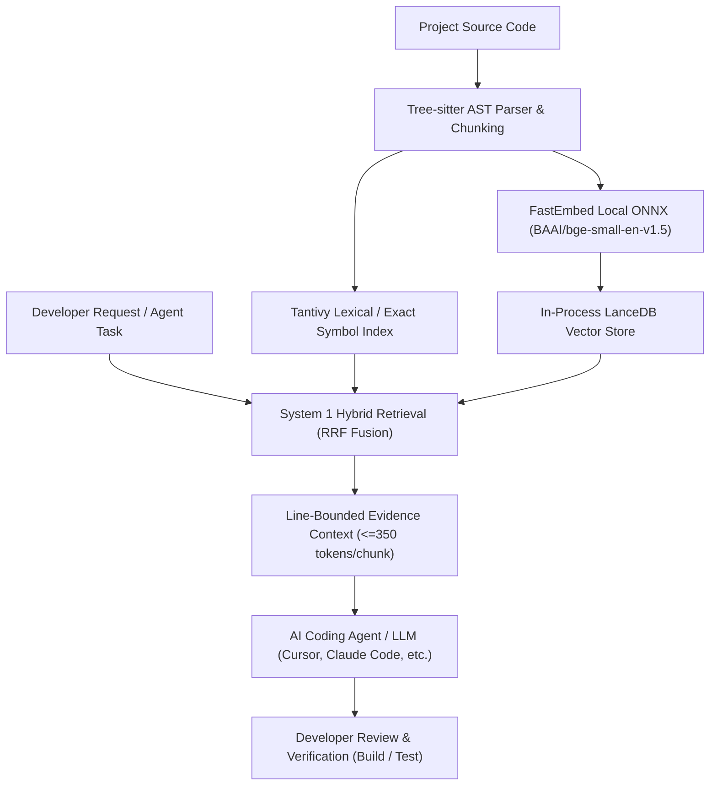

# PolyFabric

PolyFabric helps AI coding agents understand your project using less prompt context. It indexes your code locally, finds relevant functions and references, and gives your chosen model focused snippets with file and line references. Connect it to an MCP-capable IDE or use its Python API for code search, editing assistance and debugging.

| **78/78 (100.0%)** | **-7.58% Total Tokens** | **Monitored Read-Only Pilot** |
|:---:|:---:|:---:|
| **Recomputed accepted attempts** across 26 tasks $\times$ 3 trials | **Fewer total tokens** vs. previous PolyFabric baseline | **MCP write rejection & CLI paths verified** ([Candidate `9ca5287`](benchmarks/results/PILOT_VERIFICATION_9CA5287/)) |

> [!NOTE]
> **Latest Head-to-Head Benchmark Evidence:**
> Headline results below are **recomputed from published records** in [`benchmarks/results/RUN_HEAD_TO_HEAD_BASELINE_VS_IMPROVED/`](benchmarks/results/RUN_HEAD_TO_HEAD_BASELINE_VS_IMPROVED/).
> Tested versions: Baseline ([`eda7e0e`](https://github.com/vishalvermauts/PolyFabric/commit/eda7e0e)) vs. Improved ([`2ce529e`](https://github.com/vishalvermauts/PolyFabric/commit/2ce529e)). Later documentation/handover commits were not benchmarked.
> Token reductions are **not verified dollar savings**; provider billing deltas remain unresolved. [Evidence guide →](docs/EVIDENCE.md) · [Release readiness report →](docs/POLYFABRIC_RELEASE_READINESS_REPORT.md)

---

## 1. What PolyFabric Does

- **Finds relevant code:** Resolves exact AST symbols (<15 ms), lexical matches, and vector semantic candidates without sending entire files to models.
- **Builds focused context:** Assembles line-bounded code intervals and reference definitions into a compact prompt payload.
- **Shows traceable provenance:** Annotates every evidence snippet with repository, file path, symbol name, and line numbers.
- **Fits existing agent workflows:** Connects as a standard Model Context Protocol (MCP) stdio server or in-process Python library; the coding model still generates the answers and edits.

### A practical example

> **Developer request:** “Change the soil-moisture alert threshold.”

Instead of dumping multiple whole source files (e.g. 10k–30k tokens) into the prompt, PolyFabric locates the exact alert interface and threshold logic. The agent receives focused snippets (~350–800 tokens), plans the edit, and runs its standard build and test verification.

---

## 2. Latest Results: Head-to-Head Comparison

The completed head-to-head benchmark compares baseline PolyFabric (`eda7e0e`) with improved PolyFabric (`2ce529e`) on [`FarmWatch`](https://github.com/vishalvermauts/FarmWatch) pinned to commit `201321eb045f9b5170007fc26def90e4d13bf564`, evaluated with `gemini-2.5-flash` via Helix Gateway.

**Matrix:** 26 tasks $\times$ 3 trials $\times$ 2 arms = **156 evaluated attempts** (78 attempts per arm), with at most one repair per attempt.

| Metric | Baseline PolyFabric (`eda7e0e`) | Improved PolyFabric (`2ce529e`) | Improvement / Delta |
| :--- | :---: | :---: | :---: |
| **Evaluated Attempts (Denominator)** | 78 attempts | 78 attempts | 26 tasks $\times$ 3 trials |
| **Accepted Attempts (incl. repairs)** | 75 / 78 (96.15%) | **78 / 78 (100.0%)** | **+3.85% (+3 accepted attempts)** |
| **First-Pass Accepted (0 repairs)** | 65 / 78 (83.33%) | **71 / 78 (91.03%)** | **+7.70% (+6 first-pass passes)** |
| **Repairs Attempted / Successful** | 13 attempted / 10 passed | **7 attempted / 7 passed** | **-46.2% fewer repair calls needed** |
| **Unsuccessful Attempts (Failed)** | 3 (3.85%, all UI-02) | **0 (0.00%)** | **Zero failures on improved arm** |
| **Negative Task First-Pass Repairs** | 6 repair calls (hallucinations) | **0 repair calls (clean abstention)** | **100% first-pass clean abstention** |
| **Prompt / Input Tokens** | 255,968 | **253,527** | **-0.95%** |
| **Completion / Output Tokens** | 71,682 | **49,292** | **-31.23%** (less repair waste) |
| **Total Tokens Consumed** | 327,650 | **302,819** | **-7.58% token reduction** |
| **Indexed Project Chunks** | 924 chunks | **642 chunks** | **-30.5% chunk reduction** |
| **Cold Initial Indexing Time** | 57,884 ms (57.9 s) | **37,605 ms (37.6 s)** | **-35.0% faster indexing** |
| **Peak Indexing RAM (RSS)** | 3,803.5 MB | **1,542.9 MB** | **-59.4% memory footprint reduction** |
| **Median Warm Retrieval Latency** | 32.26 ms | **23.32 ms** | **-27.7% faster warm search** |

### Verified Evidence Distinctions & Known Limitations

- **Recomputed from published records:** All headline metrics above were verified and recomputed from raw per-attempt records in [`benchmarks/results/RUN_HEAD_TO_HEAD_BASELINE_VS_IMPROVED/`](benchmarks/results/RUN_HEAD_TO_HEAD_BASELINE_VS_IMPROVED/) (493 files, SHA-256 verified in [`checksums.sha256`](benchmarks/results/RUN_HEAD_TO_HEAD_BASELINE_VS_IMPROVED/checksums.sha256)).
- **Token reductions $\neq$ verified dollar savings:** LiteLLM gateway reported spend ($0.1869) vs. client formula spend ($0.0676) remains **UNRESOLVED** pending itemized transaction logs.
- **Tested commits:** Metrics belong to tested commits `eda7e0e` and `2ce529e`. Later documentation and handover commits were not benchmarked.
- **Older comparisons (vs. `rg` and Whole-File Context):** Detailed historical results comparing early PolyFabric against ripgrep and whole-file context are preserved in the [Evidence Guide](docs/EVIDENCE.md#2-historical-comparison-search-baselines-run_20261013_farmwatch_3key_corrected).
- **Targeted pilot checks:** Release candidate `9ca5287` was verified for MCP write rejection, byte immutability, and relative CLI paths in [`PILOT_VERIFICATION_9CA5287`](benchmarks/results/PILOT_VERIFICATION_9CA5287/).
- **StructZero integration:** Integration with StructZero remains **planned**; the benchmark evaluated PolyFabric standalone.

---

## 3. Compact Architecture



---

## 4. Quickstart & Installation

For a step-by-step pilot onboarding walkthrough, consult [PILOT_QUICKSTART.md](PILOT_QUICKSTART.md).

### Easiest Option: Paste This Prompt into Your Coding Agent

```text
Set up PolyFabric for this project's code search and task context:
https://github.com/vishalvermauts/PolyFabric

Read its current README, PILOT_QUICKSTART.md, and source before setup. Clone PolyFabric
into a separate tools directory outside my target project, check out tag v0.2.0-rc1,
create a dedicated Python virtual environment, and install it with python -m pip install -e .

Use this project's absolute root and a unique project name. Set an isolated,
absolute INFINITE_MEMORY_HOME and INFINITE_MEMORY_DB_PATH outside the source
tree; use the same values for indexing and the MCP server.

Configure this IDE's supported MCP settings using the virtual environment's
absolute Python executable, args ["-m", "infinite_memory.server"], and:
POLYFABRIC_ENABLE_SERVER=1
POLYFABRIC_READ_ONLY=1
INFINITE_MEMORY_HOME=<absolute state directory>
INFINITE_MEMORY_DB_PATH=<absolute database directory>

Preserve existing MCP settings. If this client cannot configure MCP
automatically, show me the exact configuration and restart instructions.
Do not claim the connection works until you initialize MCP and list tools.

Index/register my project through mesh_index_repository(project_name,
repository_path). Inspect indexing errors and chunk counts. Demonstrate
mesh_build_task_context on a real symbol or feature from this project.
If it is empty, explain that there is no source to retrieve yet.

For later coding tasks, call mesh_build_task_context before proposing edits;
use project-scoped search and expand incomplete evidence with direct reads
or exact reference searches. Refresh the index after source changes.
Do not assume all callers or imports are present in bounded context.

Keep PolyFabric source-write mode disabled. Let the coding agent propose
changes through its normal review, build and test workflow. Do not alter my
project merely to demonstrate setup, run benchmarks, or make paid LLM calls.
Report install location, installed Git commit, project name, state paths,
MCP connection status, and a sample retrieval.
```

### Manual Installation

Requires Git and Python 3.10+. No generative AI API key is needed for local retrieval.

```bash
git clone https://github.com/vishalvermauts/PolyFabric.git
cd PolyFabric
git checkout v0.2.0-rc1
python -m venv .venv
```

**macOS / Linux:**
```bash
.venv/bin/python -m pip install -e .
export INFINITE_MEMORY_HOME="$HOME/.polyfabric/my-project"
export INFINITE_MEMORY_DB_PATH="$HOME/.polyfabric/my-project/db"
export POLYFABRIC_READ_ONLY=1
.venv/bin/python -m infinite_memory.cli register my-project /absolute/path/to/project
```

**Windows PowerShell:**
```powershell
.\.venv\Scripts\python.exe -m pip install -e .
$env:INFINITE_MEMORY_HOME = "$env:USERPROFILE\.polyfabric\my-project"
$env:INFINITE_MEMORY_DB_PATH = "$env:USERPROFILE\.polyfabric\my-project\db"
$env:POLYFABRIC_READ_ONLY = "1"
.\.venv\Scripts\python.exe -m infinite_memory.cli register my-project "C:\absolute\path\to\project"
```

### Connect Through MCP

Add the following to your IDE's MCP configuration (e.g. `~/.cursor/mcp.json`):

```json
{
  "mcpServers": {
    "polyfabric": {
      "command": "/absolute/path/to/PolyFabric/.venv/bin/python",
      "args": ["-m", "infinite_memory.server"],
      "env": {
        "POLYFABRIC_ENABLE_SERVER": "1",
        "POLYFABRIC_READ_ONLY": "1",
        "INFINITE_MEMORY_HOME": "/absolute/path/to/polyfabric-state/my-project",
        "INFINITE_MEMORY_DB_PATH": "/absolute/path/to/polyfabric-state/my-project/db"
      }
    }
  }
}
```

*Note: On Windows, use `C:/absolute/path/to/PolyFabric/.venv/Scripts/python.exe` and absolute Windows paths.*

---

## 5. Supported Pilot Scope & Critical Boundaries

- **Monitored Developer-Reviewed Scope:** PolyFabric is approved as a read-only code-context component for existing-code exploration, editing assistance, and debugging. All proposed code edits must be reviewed and tested by a human developer or host agent.
- **Fail-Closed Read-Only Protection:** Setting `POLYFABRIC_READ_ONLY=1` strictly disables PolyFabric's `mesh_write_file` tool. It does not block internal index creation/updates, nor does it block edits made by the host IDE/agent via other tools.
- **Reference Completeness:** Bounded context retrieves high-probability snippets; it does not guarantee 100% transitive call-graph coverage. Always verify imports and call sites before executing large cross-file refactors.
- **Local Compute & Memory:** FastEmbed downloads ONNX weights (~130 MB) on first run. Memory consumption scales with codebase size; FarmWatch peak indexing RSS measured 1.54 GB. Size host environments appropriately.

---

## 6. Technology Stack

| Layer | Technology and Role |
|---|---|
| **Runtime** | Python 3.10+; tested on Python 3.14 / Linux Debian 13 x86_64 |
| **Parsing** | Tree-sitter AST parsers for TypeScript/TSX, JavaScript, Python, Go, and Rust |
| **Embeddings** | FastEmbed running local ONNX Runtime (`BAAI/bge-small-en-v1.5`, 384 dimensions) |
| **Vector & Full-Text Store** | Embedded LanceDB with Tantivy full-text index |
| **Hybrid Ranking** | Asymmetric Reciprocal Rank Fusion (RRF) combining vector and lexical rankings |
| **Protocol** | Model Context Protocol (MCP) JSON-RPC stdio server |
| **License** | Apache 2.0 |

---

## 7. Evidence Links & Documentation

- [Pilot Quickstart Guide](PILOT_QUICKSTART.md) — Pilot setup, runtime bounds, rollback instructions, and feedback template.
- [Evidence Guide](docs/EVIDENCE.md) — Recomputed benchmark metrics, historical search baselines, and limitations.
- [Head-to-Head Benchmark Evidence Directory](benchmarks/results/RUN_HEAD_TO_HEAD_BASELINE_VS_IMPROVED/) — All 493 raw attempts, ledger, manifest, and SHA-256 checksums.
- [Candidate 9ca5287 Verification Evidence](benchmarks/results/PILOT_VERIFICATION_9CA5287/) — MCP read-only denial, byte immutability, and CLI path normalization records.
- [Release Readiness Report](docs/POLYFABRIC_RELEASE_READINESS_REPORT.md) — Comprehensive independent audit and release assessment.
