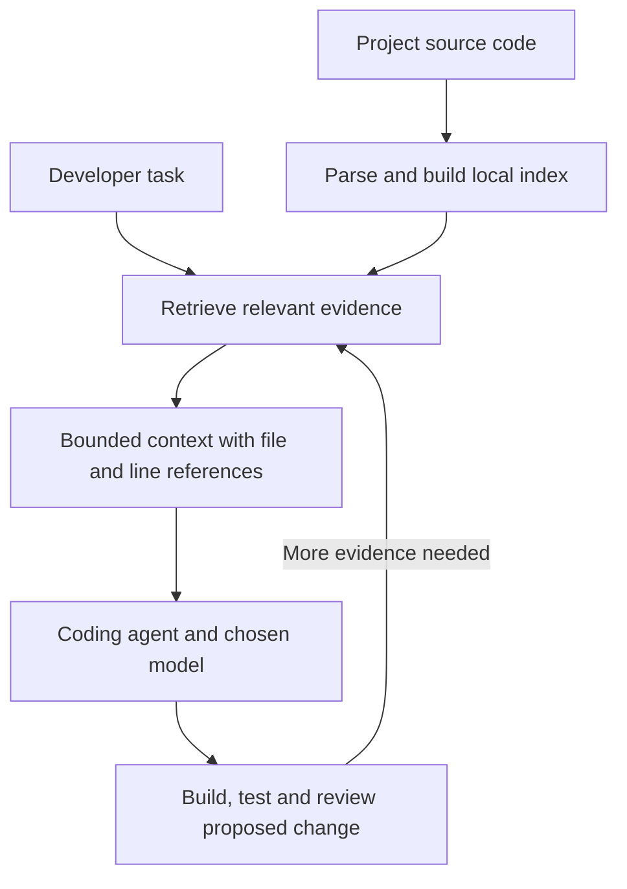

# PolyFabric

**Relevant code context for AI coding agents, with fewer tokens sent to the model.**

PolyFabric is a local code-retrieval and context engine. It indexes an existing project, finds the functions and surrounding code relevant to a task, and gives an AI coding agent a focused evidence pack with file paths and line numbers. The language model then uses that context to explain, generate or edit code.

The goal is simple: **help agents understand a codebase without repeatedly sending large files to a model.** PolyFabric can connect through MCP or an in-process Python API. It is a retrieval engine, not a separately trained coding model.

## How it saves tokens

A coding agent needs source code to make a useful change. Sending entire files can consume many input tokens, even when only a small part of each file matters. PolyFabric retrieves smaller, relevant sections and assembles them into task context.

For example, an instruction such as “change the soil-moisture alert threshold” can be paired with the relevant alert logic instead of several complete UI components. The benefit depends on retrieving enough evidence to make the change correctly; a smaller prompt alone is not a successful outcome.

**In the recorded 26-task FarmWatch benchmark, PolyFabric used 97.38% fewer prompt tokens than whole-file context and 52.66% fewer than targeted search.** These figures come from saved request records, including repairs. They describe this benchmark, not guaranteed savings on every project.

## Recorded benchmark: token savings and task outcomes

The comparison used the same TypeScript/React/Express project, `gemini-2.5-flash`, and **26 tasks × 3 trials × 3 approaches = 234 evaluated attempts**. Each approach had 78 attempts, with at most one repair request per attempt.

- **PolyFabric:** retrieved code snippets assembled into task context.
- **Targeted search:** `rg` (ripgrep) searches and bounded file reads. This is a separate baseline, not a PolyFabric function.
- **Whole-file context:** complete files supplied by the benchmark's context-gathering policy. This does not represent every competing coding agent.

| Recorded measurement | PolyFabric | Targeted `rg` search | Whole-file context |
|---|---:|---:|---:|
| Prompt/input tokens | **252,957** | 534,309 | 9,658,300 |
| Completion/output tokens | 81,150 | 95,488 | 88,280 |
| Total input + output tokens | **334,107** | 629,797 | 9,746,580 |
| Accepted attempts, including repairs | **74/78 (94.87%)** | 64/78 (82.05%) | 62/78 (79.49%) |
| Accepted before repair | 59/78 | 54/78 | 57/78 |
| Model requests, including repairs | 97 | 102 | 99 |
| Median end-to-end time per attempt | 6.86 s | **4.58 s** | 8.03 s |

| PolyFabric reduction | Versus targeted search | Versus whole-file context |
|---|---:|---:|
| Prompt/input tokens | **52.66%** | **97.38%** |
| Total input + output tokens | **46.95%** | **96.57%** |

**What this shows:** in this recorded run, smaller context coincided with higher task acceptance than both baselines. PolyFabric was faster than whole-file context at the median, but slower than targeted search. End-to-end timing includes work beyond model generation; token savings do not guarantee faster responses.

**What remains unverified:** dollar savings. LiteLLM gateway spending has not been reconciled with the client ledger. Provider pricing, cached inputs, reasoning tokens and retrieval/indexing overhead affect economics. We do not equate 97.38% fewer prompt tokens with 97.38% lower API bills.

This is an internal, single-codebase benchmark, not independent certification. The three trials repeat the same 26 tasks; they are not 78 distinct tasks. Some launch metadata was not captured. “Accepted” means accepted by the runner's checks, not a production deployment guarantee.

**Verify the evidence:** [summary](benchmarks/results/RUN_20261013_FARMWATCH_3KEY_CORRECTED/summary.json) · [298 request records](benchmarks/results/RUN_20261013_FARMWATCH_3KEY_CORRECTED/client_request_ledger.jsonl) · [234 attempt outcomes](benchmarks/results/RUN_20261013_FARMWATCH_3KEY_CORRECTED/per_attempt_results.jsonl) · [task manifest](benchmarks/results/RUN_20261013_FARMWATCH_3KEY_CORRECTED/task_manifest.json) · [billing disclosures](benchmarks/results/RUN_20261013_FARMWATCH_3KEY_CORRECTED/reconciliation_report.json).

The table's token totals and acceptance counts were cross-checked against those saved ledgers for this documentation update. **No experiments were rerun.** See the [evidence guide](docs/EVIDENCE.md) for the methodology, limitations and other reports.

## How PolyFabric works

1. **Index the project.** Parse supported source files into code chunks with file, symbol and line metadata. Create local embeddings and store the records.
2. **Find relevant evidence.** Search exact symbols, lexical matches and vector similarity. Hybrid ranking combines lexical and semantic candidates; repository-aware retrieval supports multi-project queries.
3. **Assemble task context.** Select relevant files and code intervals, include surrounding context, and format evidence for the coding agent.
4. **Let the agent act and verify.** The model proposes a change. The host agent or application applies its own build, test, review and approval workflow.



Local retrieval does not require a paid generative-model call. Embedding weights require an initial download; inference can then run locally with cached dependencies and weights. If the host agent uses a cloud model, the supplied context still goes to that provider.

## Planned integration with StructZero

[StructZero](https://www.structzero.app/) coordinates AI agents to plan, build and verify software. **The proposed role for PolyFabric is the shared code-context layer beneath those agents.** This section describes the integration plan; the FarmWatch results are not measurements of a deployed StructZero integration.

For each task, StructZero would request a bounded evidence pack from PolyFabric before calling a model. Agents would receive the relevant code, references and task instructions. After an edit, the index and any reused evidence would be refreshed or invalidated against the new project version.

| StructZero workflow | Planned use of PolyFabric | Intended benefit |
|---|---|---|
| Code generation and editing | Retrieve existing components, interfaces and nearby implementation before proposing changes | Reduce source text in prompts while preserving project context |
| Debugging and repair | Retrieve code relevant to a failing check; expand evidence when the first context is incomplete | Reduce repeated broad file reads and unnecessary model turns |
| Multi-agent debate and review | Give agents versioned evidence packs and require references for code-related claims | Reduce repeated repository discovery; make disagreement easier to inspect |
| Security review | Supply relevant source to security reviewers and scanners | Focus review context; retrieval itself does not establish security |
| Android pipeline debugging | Start with supported backend/shared-code context; add and validate Java/Kotlin, Gradle and build-log support | Extend focused retrieval to Android-specific failures after connector/parser work |
| Research and architecture | Ground code-related research in repository evidence; add document connectors separately | Connect recommendations to implementation; external research retrieval is not currently established |

Before rollout, StructZero would need project/tenant access controls, commit-aware context reuse, token budgets, stale-index detection, fallback reads and per-agent usage attribution. A shared evidence pack still consumes tokens when sent to each model; reuse does not make those calls free.

**Success would be measured by tokens and reconciled cost per accepted task**, alongside latency and failure rates, against StructZero's existing workflow. The FarmWatch percentages are evidence to investigate this opportunity, not a forecast of StructZero savings.

## Technology stack

| Layer | Technology and role |
|---|---|
| Core | Python 3.10+; package name `infinite-memory-protocol` |
| Code parsing | Tree-sitter for Python, TypeScript/TSX, JavaScript, Go and Rust; sliding-window fallback for other indexed text formats |
| Local embeddings | FastEmbed with ONNX Runtime; default `BAAI/bge-small-en-v1.5`, 384 dimensions |
| Storage and search | Embedded LanceDB; lexical/FTS search and vector retrieval |
| Ranking | Exact/fuzzy symbol routes, hybrid reciprocal rank fusion and repository diversity handling |
| Agent interface | MCP stdio server and direct Python APIs |
| File updates | Watchdog-based watchers and file-level indexing operations |
| Optional investigation | Bounded System 2 investigation layer; real-model use needs a configured provider |
| License | Apache 2.0 |

Dependencies and version ranges are recorded in [pyproject.toml](pyproject.toml). See [the implementation](src/infinite_memory/) for the current contracts.

## Use it in an existing project

### Install

```bash
git clone https://github.com/vishalvermauts/PolyFabric.git
cd PolyFabric
python -m venv .venv
source .venv/bin/activate
# Windows PowerShell: .venv\Scripts\Activate.ps1
pip install -e ".[dev]"
```

Native dependencies and model downloads must be available during setup. The following example shows the current Python interfaces; it is an instruction to run in your environment, not a claim that it was executed during this documentation update.

### Index and build code context

```python
from pathlib import Path
from infinite_memory.core.indexer import index_repository
from infinite_memory.core.store import VectorStore
from infinite_memory.core.task_context import build_task_context

repo_root = Path("/absolute/path/to/project").resolve()
store = VectorStore(db_path="./.polyfabric_index")

stats = index_repository(repo_root, "my-project", store=store)
context = build_task_context(
    store=store,
    instruction="Find the code that handles the soil-moisture alert threshold",
    repo_root=repo_root,
    project_name="my-project",
    max_files=6,
)
print(context["context_text"])
# Supply this context to your agent alongside the task instructions.
# Apply changes through the agent's own verification and approval workflow.
```

### Connect through MCP

Use the virtual environment's Python executable and the same database path used for indexing:

```json
{
  "mcpServers": {
    "polyfabric": {
      "command": "/absolute/path/to/PolyFabric/.venv/bin/python",
      "args": ["-m", "infinite_memory.server"],
      "env": {
        "POLYFABRIC_ENABLE_SERVER": "1",
        "INFINITE_MEMORY_DB_PATH": "/absolute/path/to/.polyfabric_index"
      }
    }
  }
}
```

On Windows, use the corresponding `.venv\\Scripts\\python.exe` path. Register/index projects through `mesh_index_repository(project_name, repository_path)` so project-aware tools can resolve the repository root. Relevant tools include `mesh_fast_search`, `mesh_build_task_context`, `mesh_list_projects`, `pinpoint_symbol` and `mesh_investigate`. Exact availability depends on the installed MCP dependency and client; see [server.py](src/infinite_memory/server.py).

Configuration names in the current code include `INFINITE_MEMORY_HOME`, `INFINITE_MEMORY_DB_PATH` and `INFINITE_MEMORY_EMBED_MODEL`; see [config.py](src/infinite_memory/config.py).

## Current boundaries and development status

- **Beta:** intended for evaluation and controlled integration. Broad concept search, typo handling and cross-project evidence remain uneven; global refactoring needs complete reference checks.
- **Memory and indexing are real costs:** a separate saved FarmWatch verification recorded approximately 3.77 GB peak process RSS. That is not benchmark-wide or universal memory usage, and no sub-250-MB guarantee is made.
- **Evidence can be incomplete:** neither retrieval nor secret masking guarantees correctness, absence of hallucinations, or security. Host-side validation remains necessary.
- **Experimental results stay separate:** the [improvement-plan experiment](https://github.com/vishalvermauts/PolyFabric/blob/732f529da33aa60e214067ae473e65ee66c45dbf/benchmarks/results/plan_experiment_20261015/report.md) used a different corpus/embedding policy and has not been merged into `main`. It found gains in symbol retrieval, continuing cross-project weaknesses, and an ANN speed/recall tradeoff. It is not additional proof of API-token savings.
- **Historical corrections remain visible:** invalid retrieval runs and unresolved billing are retained in the [evidence guide](docs/EVIDENCE.md), rather than combined into a best-case headline.

## Reports and further reading

- [Evidence guide: methodology, raw records and all report locations](docs/EVIDENCE.md)
- [Historical retrieval benchmarks and ablation studies](docs/benchmarks/README.md)
- [All recorded benchmark artifacts](benchmarks/results/)
- [Test source](tests/) and [CI workflow](.github/workflows/test.yml) — existing checks, not a fresh test run for this edit
- [Previous detailed README, preserved as a historical snapshot](docs/README_ARCHIVE_20261015.md)
- [License](LICENSE)
