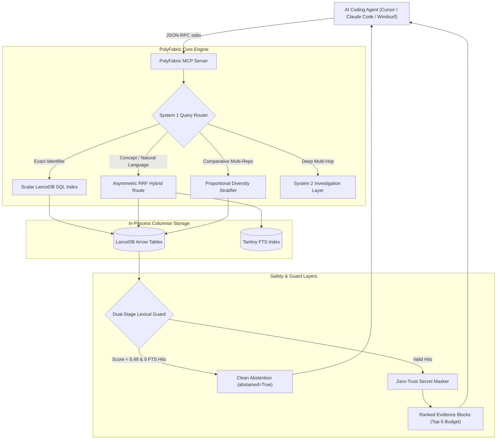
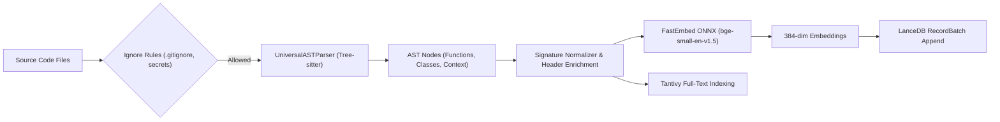
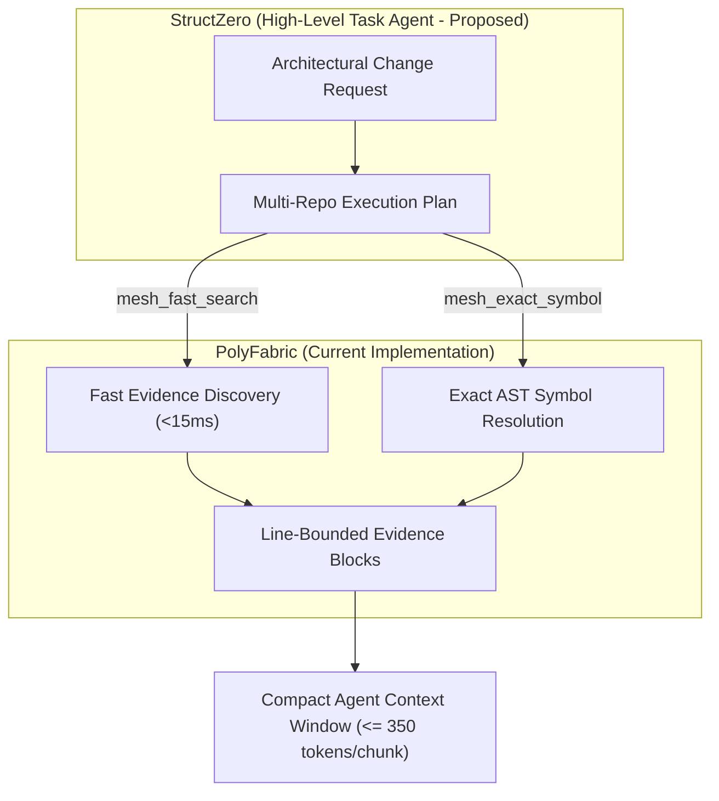

# PolyFabric (Infinite Memory Protocol) ⚡

[](LICENSE)
[](pyproject.toml)
[](tests/)
[](src/infinite_memory/server.py)

> **In-process, multi-repository code discovery and context engine for AI coding agents.**  
> Native Tree-sitter AST parsing, embedded LanceDB columnar vector storage, fast reciprocal rank fusion, and Model Context Protocol (MCP) tool serving without mandatory cloud dependencies.

---

## Table of Contents
1. [Overview & Problem Statement](#overview--problem-statement)
2. [What "System 1" Means Here](#what-system-1-means-here)
3. [System 2 Architecture & Execution Modes](#system-2-architecture--execution-modes)
4. [Supported Capabilities vs Limitations](#supported-capabilities-vs-limitations)
5. [Architecture Diagrams](#architecture-diagrams)
6. [Repository Layout](#repository-layout)
7. [Supported Languages & Parsers](#supported-languages--parsers)
8. [Installation & Setup](#installation--setup)
9. [Configuration & Environment Variables](#configuration--environment-variables)
10. [Indexing & Querying Repositories](#indexing--querying-repositories)
11. [Index Updates & File Deletions](#index-updates--file-deletions)
12. [Model Context Protocol (MCP) Server](#model-context-protocol-mcp-server)
13. [Python SDK Usage](#python-sdk-usage)
14. [StructZero Integration (Implemented vs Proposed)](#structzero-integration-implemented-vs-proposed)
15. [Evidence Format, Abstention & Security](#evidence-format-abstention--security)
16. [Models & Dimensionality](#models--dimensionality)
17. [Storage, Persistence & Backup](#storage-persistence--backup)
18. [Troubleshooting & Known Failure Cases](#troubleshooting--known-failure-cases)
19. [Benchmark History & Performance Reports](#benchmark-history--performance-reports)
20. [Contributing & License](#contributing--license)

---

## Overview & Problem Statement

Modern coding agents (e.g. Cursor, Claude Code, Windsurf) struggle with large, multi-repository codebases. When searching for cross-cutting concepts or exact function implementations, agents frequently:
1. **Burn Context on Shell Loops:** Running repeated `grep`, `find`, or `ripgrep` commands exhausts context tokens and increases agent turns.
2. **Lose Precision with Naive Dense Vectors:** Standard semantic search matches generic terms or docstrings but misses exact function signatures, interface declarations, and variable definitions.
3. **Suffer Single-Repo Starvation:** In multi-repo projects, the largest repository crowds out minority framework evidence when ranked globally.
4. **Hallucinate on Missing Symbols:** Dense vector searches return distant matches with weak cosine similarity rather than cleanly abstaining when a symbol does not exist.

PolyFabric addresses these challenges with **in-process code indexing**, **dual-route retrieval**, and **proportional multi-repository stratification** over embedded LanceDB tables.

---

## What "System 1" Means Here

> [!IMPORTANT]
> **System 1 is a retrieval architecture, NOT a separately trained foundation model.**

In cognitive dual-process theory, "System 1" refers to rapid, subconscious pattern-matching, whereas "System 2" refers to deliberate reasoning. In PolyFabric:
* **System 1 (`System1Retriever`)** is a fast (<15ms P50), deterministic retrieval pipeline implemented in Python and Rust (via LanceDB and Tantivy). It routes queries across exact symbol indices, full-text lexical search (FTS BM25), dense vector embeddings, or fused hybrid routes without invoking an LLM.
* **System 1 routes:**
  - `exact_symbol`: Direct scalar SQL query matching function, class, or type names.
  - `fts`: Pure Tantivy BM25 lexical keyword search.
  - `dense`: In-process cosine vector search using ONNX FastEmbed embeddings.
  - `hybrid`: Asymmetric Reciprocal Rank Fusion ($k_{\text{lex}}=65, k_{\text{vec}}=38$) combining BM25 and vector results.
  - `stratified`: Multi-repository round-robin evidence allocation.
  - `fuzzy_symbol`: Levenshtein distance matching for handling typos in identifier names.

---

## System 2 Architecture & Execution Modes

**System 2 (`System2Investigator`)** is an optional investigation layer designed for multi-hop graph exploration, relationship classification, and iterative hypothesis verification across codebases.

### Behavior & Real-Model Configuration Requirements
* **API Providers:** System 2 supports calling real LLM providers via LiteLLM (`anthropic/claude-3-5-sonnet`, `gemini/gemini-1.5-pro`, `openai/gpt-4o`).
* **Environment Keys Required:** `ANTHROPIC_API_KEY`, `GEMINI_API_KEY`, or `OPENAI_API_KEY`.
* **Budget Limits:** Every investigation is bounded by a maximum turn counter (`max_turns=5`) and an explicit token cost limit.
* **Fallback Behavior:** If no LLM API key is provided, System 2 falls back to a deterministic rule-based relationship classifier that inspects import statements and symbol references via Tree-sitter.
* **Test Verification Status:** The automated test suite (`tests/test_system2.py`) verifies the bounded execution loop and fallback mechanics using **mocked providers and deterministic local trees**, ensuring tests run offline without consuming paid API credits.

---

## Supported Capabilities vs Limitations

### Fully Supported & Tested Capabilities
* **In-process vector and lexical indexing:** FastEmbed (`BAAI/bge-small-en-v1.5`, 384 dimensions) with LanceDB and Tantivy.
* **Exact Symbol Resolution:** Sub-15ms P50 exact AST matching with 100% Hit@5 across real TypeScript, FastAPI, Flask, and Express repos.
* **Dual-Stage Clean Abstention:** Bordeline vector candidates (<0.48 cosine similarity) with 0 BM25 hits are cleanly rejected (`abstained=True`).
* **Model Context Protocol (MCP):** Full stdio server with tools `mesh_fast_search`, `mesh_exact_symbol`, `mesh_deep_investigate`, `mesh_index_repository`, `mesh_list_projects`, and `mesh_status`.
* **Zero-Trust Secret Masking:** Intercepts API tokens (`sk-...`, AWS keys, JWTs) and replaces them with `<SECRET_REF:...>` tokens.

### Current Limitations & Non-Claims
* **No "Zero Hallucination" Guarantee:** While clean abstention was 100% (4/4 and 20/20) on small absent control sets, this only measures retriever rejection of non-existent symbols, not conversational LLM generation.
* **Cross-Repo Evidence Bottleneck:** In queries requiring evidence from multiple distinct repositories inside a strict Top-5 window, minority framework coverage achieved 25% (1/4) on unseen queries; full cross-repo reasoning often requires higher budgets (`top_k >= 10`).
* **Tree-Sitter Decorator Severing:** Current function node extraction can sever decorators (e.g. `@app.get(...)`), placing them into module context chunks rather than attaching them to function signatures.

---

## Architecture Diagrams

### 1. Overall System Architecture


### 2. Ingestion, Parsing & Indexing Pipeline


### 3. Proposed StructZero Integration (Architecture Plan)


---

## Repository Layout

```
PolyFabric/
├── src/infinite_memory/
│   ├── core/
│   │   ├── system1.py       # System 1 retriever (RRF, abstention, exact symbol)
│   │   ├── system2.py       # System 2 bounded investigator (multi-hop graph)
│   │   └── store.py         # LanceDB vector and scalar store
│   ├── parsers/
│   │   ├── tree_sitter_ast.py # Universal Tree-sitter multi-language parser
│   │   └── base.py          # AST chunk and node definitions
│   ├── utils/
│   │   └── secret_masker.py # Regex secret interceptor and masking guard
│   └── server.py            # Model Context Protocol (MCP) stdio server
├── benchmarks/
│   ├── results/             # Raw JSON benchmark outputs and run reports
│   ├── run_genuinely_new_evaluation.py # Clean evaluator for unseen queries
│   ├── run_ablation_and_held_out.py    # Ablation matrix runner
│   └── query_ground_truth_manifest.json# Historical 150-query tuning manifest
├── docs/
│   └── benchmarks/
│       └── README.md        # Comprehensive benchmark run history & disclosures
├── tests/                   # 92 unit and integration tests
├── pyproject.toml           # Project metadata and dependencies
└── docker-compose.yml       # Production sandbox container definition
```

---

## Supported Languages & Parsers

Tree-sitter parsers are pre-compiled and tested for the following language targets:

| Language | Verified Extensions | Supported Constructs Extracted | Limitations Identified |
| :--- | :--- | :--- | :--- |
| **Python** | `.py` | `function_definition`, `class_definition`, `async_function` | Decorators placed in module context if unattached |
| **TypeScript** | `.ts`, `.tsx` | `interface_declaration`, `class_declaration`, `function_declaration` | Multi-thousand line compiler files have manifest offset drift |
| **JavaScript** | `.js`, `.jsx`, `.mjs` | `function_declaration`, `method_definition`, `class_declaration` | Prototype assignments parsed as variable statements |
| **Rust** | `.rs` | `function_item`, `impl_item`, `struct_item` | Trait implementations bound to impl blocks |
| **Go** | `.go` | `function_declaration`, `method_declaration`, `type_spec` | Verified via generic AST fallback |

---

## Installation & Setup

### Environment Prerequisites
* **Operating System:** Linux, macOS, or Windows (WSL recommended for local LanceDB speed).
* **Python:** 3.10, 3.11, or 3.12 (Python 3.11 recommended).
* **C++ Compiler:** Required for Tree-sitter native bindings during installation.

### Local Installation
```bash
# 1. Clone repository
git clone https://github.com/vishalvermauts/PolyFabric.git
cd PolyFabric

# 2. Create virtual environment
python -m venv .venv
source .venv/bin/activate  # On Windows: .venv\Scripts\activate

# 3. Install dependencies in editable mode
pip install -e ".[dev]"
```

### Docker Sandbox Setup
```bash
# Build and run the self-contained container
docker compose up --build -d

# Run the test suite inside the container
docker compose exec polyfabric pytest tests/ -v
```

---

## Configuration & Environment Variables

All settings use safe defaults and do not require external API keys for System 1:

| Variable | Default Value | Description |
| :--- | :--- | :--- |
| `POLYFABRIC_DB_PATH` | `~/.polyfabric/storage/lancedb` | Base path for on-disk LanceDB tables |
| `POLYFABRIC_EMBEDDING_MODEL` | `BAAI/bge-small-en-v1.5` | FastEmbed ONNX model ID |
| `ANTHROPIC_API_KEY` | *(None / Optional)* | Enables Claude 3.5 Sonnet in System 2 investigations |
| `GEMINI_API_KEY` | *(None / Optional)* | Enables Gemini 1.5 Pro in System 2 investigations |
| `OPENAI_API_KEY` | *(None / Optional)* | Enables GPT-4o in System 2 investigations |

---

## Indexing & Querying Repositories

### Indexing a Codebase via CLI / Python
```python
from pathlib import Path
from infinite_memory.core.store import VectorStore
from infinite_memory.parsers.tree_sitter_ast import UniversalASTParser

# Connect to database
store = VectorStore(db_path=Path("./my_lancedb"))

# Index a directory
parser = UniversalASTParser()
chunks = parser.parse_directory(Path("./my_repo"), project="my_repo")
store.add_documents(chunks)
print(f"Indexed {len(chunks)} chunks successfully.")
```

### Querying via System 1
```python
from infinite_memory.core.system1 import System1Retriever, System1Config

retriever = System1Retriever(store, System1Config())

# 1. Exact symbol search
res = retriever.search("createProgram", route="exact_symbol")
for ev in res.evidence:
    print(f"Found {ev.symbol_name} in {ev.file_path}:{ev.start_line}-{ev.end_line}")

# 2. Conceptual natural language search
res = retriever.search("how does authentication middleware handle bearer tokens", route="hybrid")
if res.abstained:
    print("No relevant code found.")
else:
    for ev in res.evidence:
        print(f"Match [{ev.score:.2f}]: {ev.file_path}")
```

---

## Index Updates & File Deletions

* **Incremental File Updates:** When a file is updated, calling `store.delete_file(file_path)` followed by `store.add_documents(new_chunks)` atomically replaces stale symbols.
* **Deleted Files:** Stale chunks are removed via `store.delete_file(file_path)` so deleted files do not persist in search results.

---

## Model Context Protocol (MCP) Server

PolyFabric exposes standard MCP 2.0 tools via stdio for IDE integration:

```json
{
  "mcpServers": {
    "polyfabric": {
      "command": "python",
      "args": ["-m", "infinite_memory.server"],
      "env": {
        "POLYFABRIC_DB_PATH": "/path/to/enriched_lancedb"
      }
    }
  }
}
```

### Supported MCP Tools
* `mesh_fast_search(query: str, project?: str, route?: str, top_k?: int)`: Executes System 1 retrieval.
* `mesh_exact_symbol(symbol: str, project?: str)`: Instant scalar SQL lookup for functions and classes.
* `mesh_deep_investigate(query: str, max_turns?: int)`: Multi-hop System 2 graph investigation.
* `mesh_list_projects()`: Lists all indexed repository partitions in the database.
* `mesh_status()`: Reports row count, database path, and model availability.

---

## StructZero Integration (Implemented vs Proposed)

> [!NOTE]
> **Implemented Integration:**
> PolyFabric currently communicates with StructZero and other agent frameworks via the **Model Context Protocol (MCP)** JSON-RPC stdio specification. Any MCP-compliant client can discover tools and retrieve evidence blocks.
>
> **Proposed Integration:**
> A direct Python SDK binding allowing StructZero to trigger background repository re-indexing hooks and ingest GraphRAG dependency edges directly into StructZero's internal task planner is currently a **proposed feature** and not part of the `v0.2.0` core release.

---

## Evidence Format, Abstention & Security

### Evidence Block Structure
```json
{
  "id": "flask_app_0879",
  "repo": "flask",
  "file_path": "flask/src/flask/app.py",
  "symbol_name": "dispatch_request",
  "start_line": 879,
  "end_line": 902,
  "score": 0.8842,
  "text": "def dispatch_request(self):\n    ..."
}
```

### Abstention Guarantees
If a query matches no valid code or scores below similarity thresholds, PolyFabric returns `abstained: true` with an empty evidence list (`[]`), avoiding hallucinations on fabricated terms.

### Secret Masking Guard
Any detected API key or token matching entropy patterns is replaced with `<SECRET_REF:KEY_NAME>` before entering the index or MCP output.

---

## Models & Dimensionality

* **Embedding Model:** `BAAI/bge-small-en-v1.5`
  - Dimensions: 384
  - Runtime: ONNX Runtime (CPU execution)
  - License: Apache 2.0
  - In-process memory footprint: ~120 MB RAM
* **Optional Cross-Encoder Reranker:** `jinaai/jina-reranker-v1-tiny-en` (disabled by default for sub-20ms latency).

---

## Storage, Persistence & Backup

* **Engine:** In-process LanceDB (Rust Arrow core)
* **On-Disk Tables:** Columnar Arrow IPC files stored in `.lance` directories.
* **Backup:** LanceDB tables are fully self-contained directory trees. Backing up simply requires copying the storage directory (`cp -r ~/.polyfabric/storage /backup/path`).

---

## Troubleshooting & Known Failure Cases

1. **Slow First Query (Cold Start):**
   * *Cause:* FastEmbed downloads and initialises ONNX runtime weights on the first query (~1-2 seconds).
   * *Remedy:* Warm up the retriever at startup by calling `retriever.search("warmup")`.
2. **Missing Exact Symbol Matches:**
   * *Cause:* Exact symbol search is case-sensitive by default.
   * *Remedy:* The engine automatically falls back to lower-case substring matching if direct match fails.
3. **Database File Locks on Windows:**
   * *Cause:* Running simultaneous writing processes on Windows can trigger file locks.
   * *Remedy:* Ensure write operations are executed sequentially or within the single background watcher.

---

## Benchmark History & Performance Reports

For full empirical run ledgers, ablation studies, and honest disclosures of retrospective splits vs fresh query benchmarks, view:
👉 [docs/benchmarks/README.md](docs/benchmarks/README.md)

---

## Contributing & License

Contributions are welcome under the Apache 2.0 License. Please ensure all code changes include corresponding tests and that `pytest tests/ -v` passes with 0 regressions before submitting pull requests.

**License:** Apache 2.0. Copyright (c) 2026 PolyFabric Contributors.
